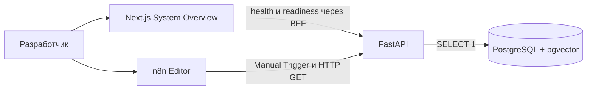

# DealMind — AI Sales Intelligence & Automation Platform

DealMind проектируется для отдела продаж онлайн-школы. Когда клиент меняет тариф или откладывает покупку, менеджеру нужны история договорённостей, следующий контакт и действующие условия курса. Руководителю нужен ответ на другой вопрос — на каком этапе и по каким причинам сделки перестают двигаться.

[](https://github.com/n1k1c0d/AI-Sales-Intelligence-Platform/actions/workflows/ci.yml?query=branch%3Adev)

## Возможности и статус проекта

| Статус | Что можно проверить |
| --- | --- |
| Implemented | FastAPI, настройки и JSON-логи с Request ID, PostgreSQL с pgvector и Alembic, Next.js System Overview, ручной workflow n8n, Docker Compose и семь jobs GitHub Actions. |
| Accepted | PHASE 0 технически принята на `382730c` в `dev`. Прошли 8 сквозных сценариев, 107 автоматических тестов и CI Gate. Следующий шаг — независимое ревью. [Протокол DM-012](docs/acceptance/PHASE_0_ACCEPTANCE.md) |
| Planned | CRM-модель и история, аналитика воронки, Risk Engine, база знаний, RAG, AI Deal Analyst, согласование и аудит внешних действий. |

**Целевой сценарий MVP.** Просроченный follow-up повысит риск сделки. Менеджер увидит причину, последнюю активность и источник условий курса, проверит предложение AI и сможет разрешить конкретное действие. Так разрозненные записи в CRM и базе знаний станут проверяемым основанием для следующего контакта.

## Архитектура PHASE 0



Python 3.12, FastAPI, SQLAlchemy, Psycopg, Alembic, PostgreSQL 17, pgvector, Next.js, React, TypeScript и n8n работают в текущем стеке. Для будущего AI Deal Analyst запланированы LangGraph, retrieval по корпоративным документам и оценка качества ответов. [Архитектура и ADR](docs/ARCHITECTURE.md)


### Структура репозитория

```text
apps/api/          FastAPI, миграции и тесты Python
apps/web/          Next.js и тесты интерфейса
automations/n8n/   экспорты workflow, примеры и контракты
infra/docker/      PostgreSQL и изолированная CI-инфраструктура
scripts/           проверки структуры, workflow и Docker
data/demo/         правила для синтетических демонстрационных данных
docs/              архитектура, ADR, runbook, сценарии и протоколы задач
.github/workflows/ GitHub Actions
```

## Local Development with Docker

**Quick Start.** Нужны Git и запущенный Docker Engine с Compose. В новом рабочем каталоге клонируйте ветку разработки. В существующем checkout начните с проверки `git status --short --branch`.

```shell
git clone --branch dev https://github.com/n1k1c0d/AI-Sales-Intelligence-Platform.git dealmind
cd dealmind
```

В корне нового клона создайте `.env` по `.env.example` (`cp -n .env.example .env` в Bash или `if (!(Test-Path .env)) { Copy-Item .env.example .env }` в PowerShell). Впишите разные случайные локальные значения для `POSTGRES_PASSWORD` и `N8N_ENCRYPTION_KEY`. Если `.env` уже есть, используйте его. Затем из корня:

```shell
docker compose config --quiet
docker compose build api web
docker compose up -d --wait db
docker compose run --rm --no-deps api alembic upgrade head
docker compose up -d --wait
docker compose ps
```

| Сервис | С хоста при портах из шаблона | Первая проверка |
| --- | --- | --- |
| Next.js | http://127.0.0.1:3000 | На System Overview нажмите Refresh Status |
| FastAPI | http://127.0.0.1:8000/docs | В Swagger выполните GET health и ready |
| PostgreSQL | `127.0.0.1:5433` | `docker compose port db 5432`, затем SQL-проверка по runbook |
| n8n | http://127.0.0.1:5678 | Настройте владельца при первом входе, импортируйте System Health Check и выполните Manual Trigger |

Фактические порты показывает `docker compose ps`. Ответ ready содержит состояние приложения и базы. У n8n в итоговом JSON есть execution ID и Request IDs для поиска в логах. [Контракты API](docs/API_CONTRACTS.md) · [Импорт и исполнение n8n](automations/n8n/workflows/system-health-check.md) · [Запуск, диагностика и остановка](docs/RUNBOOK.md)

## Continuous Integration & Quality Assurance

При push в `dev` или `main`, PR в `main` и ручном запуске workflow проверяет репозиторий, backend, БД, frontend, n8n и Docker. Итоговый `CI Gate` требует успеха всех шести jobs. Локально из корня начните с `python scripts/check_repository.py` и `python scripts/validate_n8n_workflow.py`. Для запущенного стека выполните `bash scripts/smoke_infra.sh`. [Команды тестов и результаты](docs/TEST_STRATEGY.md)

## Документация

| Задача читателя | Где искать |
| --- | --- |
| Понять продукт и текущие ограничения | [Project Context](docs/PROJECT_CONTEXT.md) · [Master Spec](docs/MASTER_SPEC.md) |
| Разобраться в компонентах и данных | [Архитектура](docs/ARCHITECTURE.md) · [Модель данных](docs/DATA_MODEL.md) · [API](docs/API_CONTRACTS.md) |
| Настроить и сопровождать стенд | [Переменные окружения](docs/ENVIRONMENT.md) · [Runbook](docs/RUNBOOK.md) |
| Показать проект и воспроизвести проверки | [Демонстрации](docs/DEMO_SCENARIOS.md) · [Стратегия тестирования](docs/TEST_STRATEGY.md) |
| Продолжить разработку | [Инструкции агента](AGENTS.md) · [Roadmap](docs/ROADMAP.md) · [Changelog](CHANGELOG.md) |

## Roadmap

В PHASE 0 проверены запуск из чистого клона, отказ и восстановление сервисов, сохранность данных. PHASE 1 вводит CRM и аналитику, PHASE 2 — события и автоматизацию n8n, PHASE 3 — знания и RAG, PHASE 4 — AI Deal Analyst с Human Approval. PHASE 5 посвящена бизнес-дашборду, PHASE 6 — качеству, развёртыванию и демонстрации. [Задачи и зависимости](docs/ROADMAP.md)

## Ограничения и безопасность

Стенд предназначен для локальной разработки. Порты публикуются на loopback. Прикладная аутентификация и изоляция организаций ещё в плане. Для демо используйте синтетические данные. Сохраняйте `.env` и ключ шифрования n8n вне Git. В PostgreSQL сейчас находится миграционный фундамент. В n8n собственная SQLite с историей запусков.

## Автор и портфолио

Репозиторий владельца n1k1c0d демонстрирует проектирование HTTP-контрактов, разделение ответственности между Python и n8n и диагностику реального отказа БД. Доказательства доступны в тестах, истории Git и протоколах приёмки. По принятому языковому стандарту README и инженерные документы преимущественно на русском, код и идентификаторы — на английском. [Сценарии показа](docs/DEMO_SCENARIOS.md) · [Языковые правила](docs/MASTER_SPEC.md)
