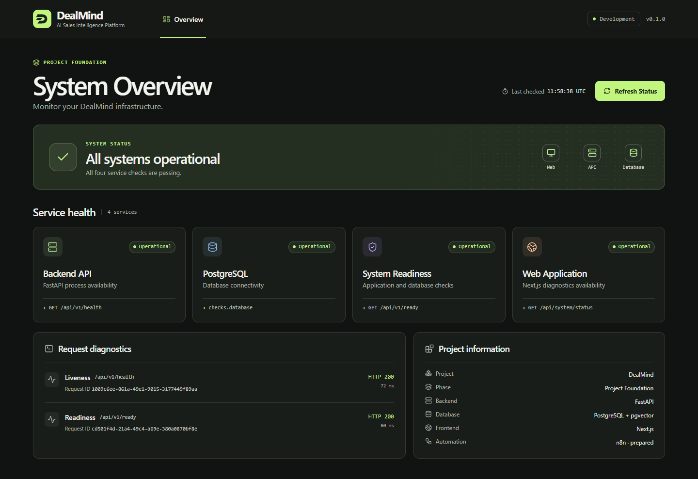

# DealMind — AI Sales Intelligence & Automation Platform

DealMind проектируется для отдела продаж онлайн-школы. Менеджер сможет открыть сделку, увидеть причину риска и решить, какое действие предпринять. Руководитель сможет перейти от показателя воронки к сделкам, на которых этот показатель рассчитан.

## Continuous Integration & Quality Assurance

[](https://github.com/n1k1c0d/AI-Sales-Intelligence-Platform/actions/workflows/ci.yml?query=branch%3Adev)

`DealMind CI` запускается при push в `dev` и `main`, при открытии и обновлении PR в `main`, а также вручную через GitHub Actions. Параллельно проверяются структура репозитория, Python, PostgreSQL с Alembic, frontend, импорт и исполнение n8n, сборка и HTTP-проверки Docker. Итоговый `CI Gate` требует успеха всех шести jobs.

Из корня можно запустить `python scripts/check_repository.py`, `python scripts/ci_stack.py n8n` и `python scripts/ci_stack.py smoke`. Команды для отдельных suites, артефакты и измеренное покрытие приведены в стратегии. Для первого запуска достаточно push в `dev`. Ручной запуск через интерфейс GitHub станет доступен, когда workflow появится в default branch. На этапе DM-010 локальные проверки пройдены, первый результат на GitHub ожидается. [Стратегия и локальные команды](docs/TEST_STRATEGY.md) · [Результаты DM-010](docs/tasks/DM-010.md)

## Проблема бизнеса

В CRM видны суммы и этапы, но из них трудно понять, кому сегодня нужен звонок и почему. Например, после разговора о рассрочке прошло больше 72 часов, следующего контакта в календаре нет, а условия оплаты изменились. Для решения нужны три разных свидетельства — история контактов, состояние сделки и действующая редакция условий курса.

## Возможности и статус проекта

| Статус | Что доступно или запланировано |
| --- | --- |
| Implemented | Docker Compose запускает Next.js, FastAPI, PostgreSQL 17 с pgvector и n8n. На странице System Overview видны состояние API и БД, время проверки и Request ID. Ручной workflow n8n System Health Check сохраняет один диагностический отчёт на запуск. Доступны Swagger UI, liveness и readiness с проверкой PostgreSQL, единый JSON-контракт ошибок, настройки APP_*, CORS, X-Request-ID, структурированные логи, тесты API и инфраструктурный smoke-тест. |
| In Progress | Идёт PHASE 0. DM-010, Testing & CI, ожидает первого подтверждённого прогона на GitHub. |
| Planned | API для синтетических CRM-данных, аналитика, Risk Engine, поиск по базе знаний с цитатами, AI Deal Analyst, интерфейс согласования и автоматизации через n8n. |

## Технологический стек

| Технологии | Назначение в целевой системе |
| --- | --- |
| Python 3.12+, FastAPI, Pydantic v2 | Типизированное REST API, бизнес-правила и проверка данных |
| SQLAlchemy 2.x, Psycopg 3, Alembic | Запросы к БД, транзакции и миграции схемы |
| PostgreSQL, pgvector | Сделки и история событий, документы и поиск по embeddings |
| LangChain components, LangGraph | Обработка документов и retrieval, управление шагами анализа сделки и ожиданием решения пользователя |
| OpenAI API, Langfuse | Начальный LLM-провайдер за заменяемым интерфейсом, трассировка и оценка ответов |
| n8n | Интеграционные события, уведомления и исполнение разрешённых действий |
| Next.js, React, TypeScript | Веб-интерфейс для менеджера и руководителя |
| Tailwind CSS, shadcn/ui, Recharts | Стили, компоненты интерфейса и графики воронки |
| uv, pytest, Ruff, Mypy | Воспроизводимое Python-окружение, тесты, стиль и проверка типов |
| Docker, Docker Compose, GitHub Actions | Локальный запуск сервисов и автоматические проверки |

## Архитектура

FastAPI Backend объединит доменные модули в одном приложении. Python и SQL рассчитают KPI и риск. RAG Engine подберёт источники, а AI Deal Analyst предложит следующий шаг по данным сделки. После подтверждения пользователем backend проверит полномочия, передаст действие в n8n и сохранит результат. [Компоненты, потоки данных и границы доступа](docs/ARCHITECTURE.md)

## Структура репозитория

Дерево показывает основные каталоги от корня Git. README каждой области описывает её назначение и ближайшую задачу. Разработка ведётся в `dev`. После проверки шага автор проекта открывает pull request в `main`.

```text
.
├── .editorconfig
├── .gitignore
├── .env.example         # Шаблон локальных настроек Compose
├── docker-compose.yml   # Web, API, PostgreSQL с pgvector и n8n
├── .github/workflows/   # Зарезервировано для CI
├── apps/
│   ├── api/             # Python-пакет, uv.lock и smoke-тесты
│   └── web/             # Next.js App Router, System Overview и Vitest
├── automations/n8n/     # Экспорты workflows и примеры интеграций
├── data/demo/           # Синтетические данные
├── docs/                # Спецификация, контекст, архитектура и roadmap
│   ├── adr/             # Решения и их основания
│   └── tasks/           # ТЗ и результаты проверки
├── infra/docker/        # Дополнительные файлы Docker-окружения
├── scripts/             # Вспомогательные операции разработки
└── README.md
```

## Getting Started

Для локального API потребуются uv и Python 3.12. Из корня репозитория выполните

```shell
cd apps/api
uv sync --locked
uv run --locked uvicorn dealmind.main:app --reload --loop asyncio:SelectorEventLoop --no-access-log --host 127.0.0.1 --port 8000
```

Откройте `http://127.0.0.1:8000/docs` для Swagger UI или `/openapi.json` на том же сервере для схемы. Маршруты `GET /api/v1/health` и `GET /api/v1/ready` показывают доступность процесса и готовность приложения. Readiness возвращает 200, когда завершён startup и PostgreSQL ответила на `SELECT 1`. При локальном запуске без пароля БД liveness остаётся 200, readiness возвращает 503. [Установка, проверки и сборка backend](apps/api/README.md)

Настройки процесса задают режим приложения, порог логирования и разрешённые origins. По заголовку `X-Request-ID` ответа можно найти событие в JSON-логах API. [Настройки и диагностика](apps/api/README.md#configuration--logging)

Для локальной разработки интерфейса потребуются Node.js 24 LTS и npm 11. Из корня выполните

```shell
cd apps/web
npm ci
npm run dev
```

Откройте `http://127.0.0.1:3000`. Если API опубликован на другом порту, задайте его origin в `apps/web/.env.local`. [Руководство frontend](apps/web/README.md)



## Local Development with Docker

Из корня репозитория можно поднять web, API, PostgreSQL 17 с pgvector и n8n. Нужны запущенный Docker Engine с поддержкой Linux-контейнеров и команда `docker compose` (Compose V2 или совместимая новая версия). На Windows это обеспечивает [Docker Desktop](https://docs.docker.com/desktop/setup/install/windows-install/).

1. При первой настройке скопируйте `.env.example` в `.env`. В PowerShell используйте `Copy-Item .env.example .env`, в Bash — `cp .env.example .env`. Если файл уже существует, сохраните его значения.
2. Заполните `POSTGRES_PASSWORD` и `N8N_ENCRYPTION_KEY` двумя независимыми случайными значениями. Для каждого можно выполнить `python -c "import secrets; print(secrets.token_hex(32))"`. Храните ключ n8n вместе с резервной копией данных. Реальный `.env` исключён из Git.
3. Если порт занят, измените в `.env` соответствующий `*_HOST_PORT`. Проверьте конфигурацию и запустите сервисы.

```shell
docker compose config --quiet
docker compose up -d --wait db
docker compose build api web
docker compose run --rm --no-deps api alembic upgrade head
docker compose up -d --wait
docker compose ps
```

При портах из шаблона System Overview доступен по `http://127.0.0.1:3000`, web liveness — по `/api/health`, диагностика — по `/api/system/status` на том же сервере. Swagger UI доступен по `http://127.0.0.1:8000/docs`, OpenAPI — по `/openapi.json` на том же сервере. PostgreSQL слушает `127.0.0.1:5433`, редактор n8n — `http://127.0.0.1:5678`. При первом входе в n8n создайте локальную учётную запись владельца. Фактические порты можно посмотреть через `docker compose ps`.

Для диагностики используйте `docker compose logs --tail 50 api` или подставьте имя другого сервиса. Команда `docker compose down` останавливает окружение и сохраняет данные. **Флаг `-v` удаляет тома PostgreSQL и n8n.** Если запуск завершается ошибкой, проверьте доступность Engine, занятость портов и заполнение `.env`. [SQL-проверки, сеть, тома и устранение ошибок](infra/docker/README.md)

## Диагностика через n8n

В локальном редакторе выберите **DealMind — System Health Check** и нажмите **Execute**. На вкладке Executions откройте конечный узел и его OUTPUT → JSON. Поля `overall_status` и `errors` показывают результат проверки. По двум Request ID можно найти конкретные обращения в логах FastAPI. При первом запуске на новом экземпляре импортируйте JSON из репозитория. [Импорт и запуск workflow](automations/n8n/workflows/system-health-check.md) · [Результаты DM-009](docs/tasks/DM-009.md)

## Roadmap

Разработка проходит через семь этапов. Сначала команда готовит локальное окружение (0), затем CRM-модель и аналитику (1), интеграции n8n (2), базу знаний и RAG (3), AI Deal Analyst (4), пользовательский интерфейс (5) и демонстрационный релиз с измерениями и сценариями (6). [Задачи, зависимости и критерии приёмки](docs/ROADMAP.md)

## Документация

- Пользователи, границы MVP, сценарии и текущее состояние — [Project Context](docs/PROJECT_CONTEXT.md).
- Ответственность модулей, владельцы данных и потоки — [Architecture](docs/ARCHITECTURE.md).
- Обоснование модульного монолита и границ n8n — [ADR-0001](docs/adr/0001-modular-monolith.md).
- Состав работ и приёмка архитектурной задачи — [DM-001](docs/tasks/DM-001.md).
- Структура monorepo и проверка правил Git — [DM-002](docs/tasks/DM-002.md).
- Python-окружение, упаковка и результаты приёмки — [DM-003](docs/tasks/DM-003.md).
- Контракты HTTP API и результаты проверки Uvicorn — [DM-004](docs/tasks/DM-004.md).
- Локальное Docker-окружение и проверка сохранности данных — [DM-005](docs/tasks/DM-005.md).
- Настройки, корреляция запросов и проверка CORS — [DM-006](docs/tasks/DM-006.md).
- Асинхронные сессии, миграции и изолированные PostgreSQL-тесты — [руководство backend](apps/api/README.md#database-architecture) и [приёмка DM-007](docs/tasks/DM-007.md).
- Снимки экрана, сценарии отказа и результаты проверки frontend — [DM-008](docs/tasks/DM-008.md).
- Полный исходный замысел и правила разработки — [Master Specification v1.0](docs/MASTER_SPEC.md).

## Ограничения

Первая демонстрация рассчитана на одну организацию и синтетические данные. Сейчас работающих AI-функций и подтверждённых production-метрик нет. Первый MVP ограничен локальным запуском, согласованными действиями и демонстрационным CRM-источником. Интеграция с реальной CRM и публичное развёртывание потребуют отдельных задач.

## Назначение для портфолио

На этом этапе можно оценить архитектурное решение и проследить путь от бизнес-проблемы до проверяемых критериев. По мере реализации к ним добавятся модели и миграции, тесты правил риска, оценки качества retrieval и прикладные workflows n8n.
