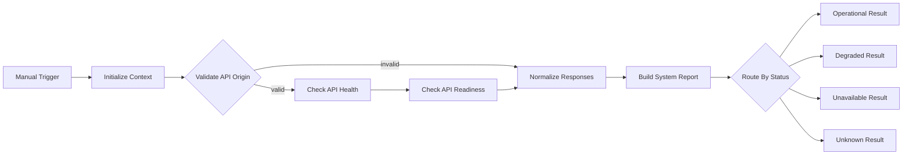

# DealMind — System Health Check

## 1. Overview

`system-health-check`, версия workflow 1.0.0, версия схемы 1.0. JSON совместим с n8n 2.48.8. [Импортируемый workflow](system-health-check.json)

## 2. Technical Purpose

Оператор может различить остановку API, отказ PostgreSQL и несовместимый HTTP-ответ, затем найти отдельный запрос в журналах FastAPI. Состояние PostgreSQL определяется через readiness приложения.

## 3. Trigger

Manual Trigger. После импорта граф сохранён как неактивный черновик. Execute в редакторе запускает его по запросу оператора.

## 4. Input Contract

Пользовательские параметры отсутствуют. Initialize Context берёт ID из `$execution.id`, время — из `$now.toUTC()` и добавляет статические значения workflow и origin. Внешний item не задаёт URL, заголовки и метод.

## 5. Output Contract

Каждая диагностическая ветка возвращает один item с одинаковыми полями.

| Поле | Смысл |
| --- | --- |
| schema_version, workflow, workflow_version | Версия формата, логическое имя и версия графа |
| execution_id | Строковый ID внутри конкретного экземпляра n8n |
| started_at, finished_at, duration_ms | UTC ISO 8601 и фактическая длительность от Initialize Context до сборки отчёта |
| overall_status | operational, degraded, unavailable или unknown |
| services.backend, services.readiness | status, http_status (число либо null), request_id (UUID v4 либо null) |
| services.database.status | operational, not_ready или unknown |
| errors | Массив объектов code, message и source (health или readiness) |

Примеры содержат безопасные выходы тестового экземпляра. Для unknown использовался управляемый тестовый HTTP-сервер. [Operational](../examples/system-health-check/operational.json) · [Degraded](../examples/system-health-check/degraded.json) · [Unavailable](../examples/system-health-check/unavailable.json) · [Unknown](../examples/system-health-check/unknown.json)

## 6. Node Responsibilities

| Узел | Тип и версия | Результат |
| --- | --- | --- |
| Manual Trigger | Manual Trigger 1 | Один ручной запуск |
| Initialize Context | Edit Fields 3.5 | Версия, execution ID, время UTC, origin |
| Validate API Origin | Switch 3.5 | Выбирает HTTP-путь или обработку ошибки конфигурации |
| Check API Health | HTTP Request 4.5 | Health, полный HTTP-ответ либо транспортная ошибка |
| Check API Readiness | HTTP Request 4.5 | Readiness независимо от результата health |
| Normalize Responses | Code 2 | Валидированные метаданные двух проб и состояние проверок |
| Build System Report | Code 2 | Время завершения, длительность, диагностический статус и массив ошибок |
| Route By Status | Switch 3.5 | Один из четырёх выходов по overall_status |
| Operational Result | No Operation 1 | Один подтверждённый operational item |
| Degraded Result | No Operation 1 | Один item при частичном отказе |
| Unavailable Result | No Operation 1 | Один item при недоступности API |
| Unknown Result | No Operation 1 | Один item с неподтверждённым состоянием |
| Transport policy, Diagnostic outcome | Sticky Note 1 | Пояснения на canvas, в исполнении не участвуют |

## 7. Data Flow



У HTTP-узлов последовательно выполняются два независимых GET. Для второго адрес строится из Initialize Context. Нормализация читает фактически исполненные именованные узлы, поэтому замена входного item HTTP-ответом сохраняет сведения о первой проверке. В ветке ошибки конфигурации выполняется ноль запросов.

## 8. Status Mapping

| Health | Readiness | Overall | Database |
| --- | --- | --- | --- |
| Валидный 200 | Валидный 200 | operational | operational |
| Валидный 200 | 503, приложение готово, БД недоступна | degraded | not_ready |
| Валидный 200 | 503, startup не завершён | degraded | unknown |
| Валидный 200 | Таймаут либо некорректный ответ | degraded | unknown |
| Ошибка | Валидный ответ | degraded | По readiness |
| Обе пробы без HTTP-ответа по сетевой причине | Без подтверждения | unavailable | unknown |
| Обе пробы без валидного контракта либо неверная конфигурация | Без подтверждения | unknown | unknown |

## 9. Error Codes

NETWORK_ERROR обозначает ошибку соединения, TIMEOUT — истечение времени, HTTP_ERROR — неожиданный HTTP-код, INVALID_RESPONSE — неверный Content-Type, JSON или структуру. DATABASE_NOT_READY и APPLICATION_NOT_READY выводятся из валидного 503. CONFIGURATION_ERROR обозначает недопустимый origin. Неизвестный сбой узла завершает execution с ошибкой. Отчёт содержит безопасные сообщения и выбранные поля HTTP.

## 10. Retry Policy

У HTTP Request установлены Retry On Fail, Max Tries = 2, Wait Between Tries = 1000 мс, Timeout = 8000 мс. Never Error передаёт полученный HTTP-ответ далее. Текстовый режим позволяет сохранить код даже для повреждённого JSON. Continue применяется только в двух узлах транспорта. Нормализация всегда проверяет error item. Для каждого из двух endpoints возможна одна повторная попытка. Общий execution timeout — 60 с.

## 11. Configuration

Origin один — `http://api:8000` в Initialize Context. Пути фиксированы — `/api/v1/health` и `/api/v1/ready`. Оба запроса используют GET и Accept: application/json. Следование перенаправлениям отключено. Окружение JS runner, Docker socket, SQL и credentials workflow не требуются.

## 12. Manual Execution

1. Из корня выполните `docker compose port n8n 5678`, откройте опубликованный адрес и войдите в свою учётную запись.
2. Откройте DealMind — System Health Check и нажмите **Execute**. Вкладка Executions показывает ID, время и статус выполнения.
3. Откройте завершившийся узел с названием Result. Переключите OUTPUT в JSON и проверьте `overall_status`, `services`, `errors`.
4. Найдите оба UUID в логах API. При необходимости повторите запуск после восстановления сервиса.

## 13. Import / Export

В новом пустом workflow откройте меню ⋯ рядом с названием и выберите Import → From file. Укажите `system-health-check.json`. Если появляется предложение подключить MCP, нажмите Skip. Проверьте узлы и нажмите Execute. Вкладка Executions сохранённого графа показывает последний запуск. Существующую рабочую копию выбирайте из списка Workflows. Публикация для Manual Trigger не требуется.

Штатный CLI также поддерживает импорт одного файла. Команды выполняются из корня репозитория. Сначала проверьте список. Повторный импорт переносимого файла создаёт новый внутренний ID, поэтому имена могут совпадать.

```shell
docker compose exec -T n8n n8n list:workflow
docker compose cp automations/n8n/workflows/system-health-check.json n8n:/tmp/dealmind-health-import.json
docker compose exec -T n8n n8n import:workflow --input=/tmp/dealmind-health-import.json
docker compose exec -T n8n n8n list:workflow
```

Для экспорта замените WORKFLOW_ID на ID нужной версии. Сырой файл храните во временном каталоге. В переносимом объекте оставьте name, nodes, connections, active=false и settings. Сохраните ID самих узлов. Удалите instance workflow ID, ownership, поля истории версий, pinData и метаданные пользователя. Сравните экспорт с Git, прогоните валидатор и импортируйте проверенную копию в отдельный экземпляр. [Штатные команды n8n](https://docs.n8n.io/hosting/cli-commands/)

```shell
docker compose exec -T n8n n8n export:workflow --id=WORKFLOW_ID --pretty --output=/tmp/dealmind-health-export.json
```

## 14. Testing

Из корня выполните `python scripts/validate_n8n_workflow.py`. Для проверки реальной инфраструктуры сначала получите operational и сверьте UUID с логами. Для отказов поднимите отдельные n8n, FastAPI и PostgreSQL с собственными сетью, значениями окружения, хранилищем и loopback-портом. В тестовой сети присвойте FastAPI имя api. Остановите тестовую БД, выполните workflow, восстановите БД и повторите. Затем повторите цикл для тестового API.

Для тестов внешнего контракта остановите тестовый API и запустите в той же тестовой сети HTTP-заглушку под именем api на порту 8000. Возвращайте управляемые ответы по двум путям. Проверьте 404/500, повреждённый JSON, неполный объект, сброс соединения и задержку свыше восьми секунд. Журнал заглушки показывает фактическое число попыток. Сравните его с результатом конечного узла. [Фактические результаты, ID и скриншоты](../../../docs/tasks/DM-009.md)

## 15. Known Limitations

Снимок отражает две последовательные пробы. При отказе API доступность БД установить невозможно. Execution ID уникален внутри своего n8n. История n8n подчиняется локальным правилам хранения. Workflow работает с двумя внутренними диагностическими маршрутами, у которых безопасные поля ответа. Перед подключением нового сервиса отдельно проверьте, какие данные попадут в историю HTTP-узла.
