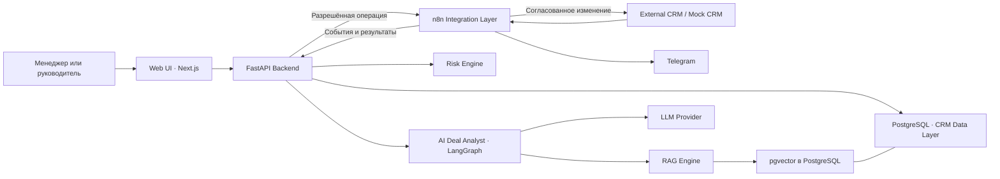
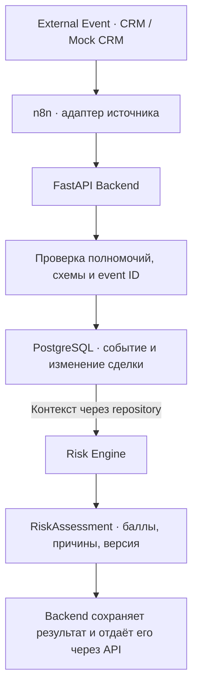
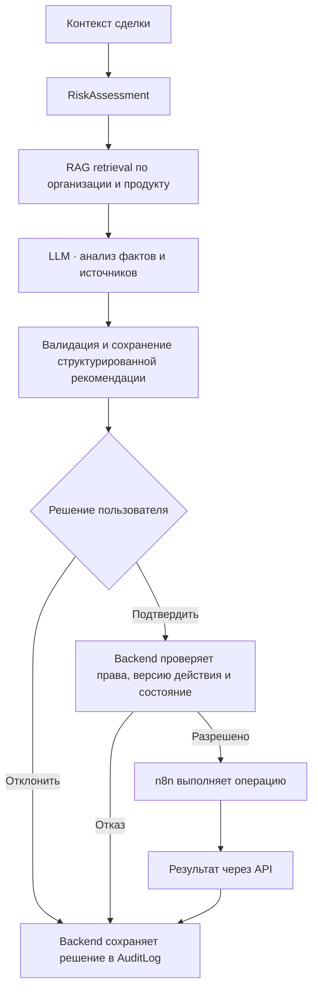

# DealMind · Architecture

## 1. Обзор архитектуры

Документ задаёт целевую архитектуру MVP. На момент DM-001 в репозитории есть каркас и документы. Контрольный сценарий для проектирования — от первого признака задержки в открытой сделке до проверяемого результата действия, подтверждённого менеджером. [Контекст продукта](PROJECT_CONTEXT.md)

## 2. Архитектурный стиль

FastAPI Backend развёртывается одним Python-приложением с модулями CRM, аналитики, риска, знаний и AI. Разделение по модулям сохраняет единый контекст сделки и позволяет записывать связанные изменения в транзакции PostgreSQL. n8n Integration Layer развёртывается отдельно и обращается к backend по интеграционным контрактам. Изменения приложений, workflow и документации версионируются в monorepo. [Основания и компромиссы](adr/0001-modular-monolith.md)

## 3. Системный контекст

Менеджер и руководитель работают через Web UI. В локальной демонстрации роль CRM выполняет синтетический источник. Адаптер реальной CRM и Telegram находятся за внешней границей системы. На схеме стрелки показывают вызовы или передачу событий. Risk Engine, RAG Engine и AI Deal Analyst входят в FastAPI Backend.

## 4. Ответственность компонентов

| Компонент | Чем владеет | Что отдаёт вызывающей стороне |
| --- | --- | --- |
| Web UI · Next.js | Представление, фильтры, состояние загрузки и форма согласования | Типизированный запрос к API, включая решение пользователя |
| FastAPI Backend | Валидация, аутентификация, авторизация, сценарии приложения и транзакции | Версионированный JSON-контракт и идентификатор операции |
| CRM Data Layer · PostgreSQL | Локальная модель CRM, история, решения, состояния и аудит | Согласованный срез данных организации через repositories |
| Analytics и Risk Engine | Формулы KPI, критерии риска, версии правил | Показатель с контекстом расчёта или оценка с основаниями |
| RAG Engine и pgvector | Индексация и retrieval доступных редакций документов | Фрагменты, метаданные и проверяемые ссылки |
| AI Deal Analyst · LangGraph | Контекст и шаги анализа, ограниченные tools, точка ожидания решения | Структурированное предложение и его основания |
| n8n Integration Layer | Webhooks, расписания, доставка, сопоставление внешних форматов, обработка интеграционных ошибок | Идентифицируемое событие или результат выполнения |
| Langfuse | Наблюдение за AI-вызовами и оценками | Trace шагов, версии модели и prompt, время и расход токенов |

## 5. Границы модулей backend

| Слой | Ответственность и допустимые зависимости |
| --- | --- |
| API / Presentation | Routes и Pydantic schemas проверяют форму запроса, получают контекст пользователя, вызывают application service и переводят результат в HTTP. |
| Application Services | Координируют сценарий, полномочия, границу транзакции, вызовы домена, repositories и внешних адаптеров через нужные контракты. |
| Domain Logic | Определяет смысл статусов, переходов, KPI и риск-правил. Получает данные и опорное время явно. Тестируется без HTTP, ORM и LLM. |
| Repositories | Выбирают и сохраняют данные организации, выполняют SQL-агрегации согласно доменным определениям. Используют SQLAlchemy и PostgreSQL. |
| Infrastructure / Integrations | Реализуют подключения к БД, провайдерам AI и n8n. Преобразуют ошибки транспорта в известные приложению исходы. |

Основное направление вызова — route → application service → domain / repository interface. Конкретные repositories и клиенты подключаются при сборке приложения. Обратный импорт FastAPI в domain и прямой вызов SQL из UI, AI tool или n8n нарушают границу. Новый интерфейс нужен там, где сценарий действительно зависит от заменяемого исполнителя.

## 6. Данные и владение записью

| Набор данных | Источник и владелец записи | Синхронизация |
| --- | --- | --- |
| Контакты, внешние сделки и активности | Во внешней CRM исходные поля меняет CRM. В демо исходные данные создаёт генератор. | n8n передаёт входные события. Backend валидирует их и записывает локальную проекцию в PostgreSQL. |
| Оценки, рекомендации, согласования, журнал операций | DealMind. Только FastAPI Backend меняет доменные таблицы. | UI и n8n читают или отправляют команды через API. Изменение в реальной CRM требует отдельной разрешённой операции. |
| Документы, редакции, фрагменты и embeddings | Backend хранит текст, метаданные и связи редакций в PostgreSQL. pgvector хранит и индексирует векторы в той же БД. | Переиндексация создаёт согласованный набор для модели и редакции. Ссылки сохраняют идентичность исходного фрагмента. |
| Состояние выполнения workflow | n8n ведёт техническую историю запусков. Backend ведёт статус бизнес-операции и аудит. | Результат приходит через API с идентификаторами операции и запуска. |

Внутренние идентификаторы — UUID. Для внешней сущности действует область уникальности «организация, источник, внешний ID». Время события и время его приёма хранятся раздельно в UTC. Деньги имеют тип Decimal / NUMERIC и валюту. Переходы по этапам образуют историю. Запоздалое событие сохраняет своё время, а порядок обновления проекции определяется контрактом источника. [Концептуальные сущности и связи](PROJECT_CONTEXT.md)

## 7. Интеграции

Входящий конверт содержит организацию, источник, event ID, внешний ID объекта, тип события, время и версию формата. Backend связывает организацию с учётными данными источника. Ключ «организация, источник, event ID» защищён ограничением уникальности. Для принятого события запись ключа, доменного изменения и результата обработки образует одну транзакцию. Повтор идентичного события возвращает прежний результат, конфликт содержимого под тем же ключом требует разбора.

Исходящая операция получает устойчивый ID, ссылку на разрешение и разрешённые параметры. n8n использует минимальные права внешнего сервиса, возвращает результат через API и не получает доступ на запись в доменные таблицы. Для тестов живую CRM заменяет локальный источник с тем же входным контрактом.

## 8. AI и RAG

1. RAG Engine принимает документ как недоверенные данные, выделяет фрагменты и сохраняет организацию, продукт, версию, позицию и модель embeddings. Размерность индекса согласуется с моделью.
2. Retrieval ограничивает поиск доступными редакциями и организацией пользователя. Фрагмент должен открываться по ссылке на конкретную версию. Если источники расходятся или не дают ответа, результат указывает ограничение.
3. LangGraph получает факты от ограниченных tools чтения контекста сделки, риска, метрик и знаний. Tool для действия создаёт черновик. Запросы к данным выполняет backend с проверкой области доступа.
4. OpenAI API подключается через provider abstraction. Pydantic проверяет структуру ответа, а сервис сверяет сделку, основания, доступность источников и допустимость предлагаемой операции. Инструкции из документов не меняют права tools.
5. Backend сохраняет рекомендацию, версию действия и решение пользователя. Возобновление графа использует сохранённое состояние. Изменение параметров действия требует нового согласования.
6. Mock providers обеспечивают локальные тесты и CI. Отдельные evaluation-наборы проверяют retrieval, соответствие ссылок, полноту оснований и отказ при недостатке знаний. Langfuse связывает шаги одного анализа без публикации содержимого клиентской переписки.

## 9. Границы API

REST API имеет префикс `/api/v1`, JSON для запросов и ответов и валидацию Pydantic. UI читает проекции и передаёт намерения пользователя. Интеграционные клиенты используют отдельные полномочия и контракты событий, доступные только их организации и источнику. Backend проверяет право на операцию при приёме команды и перед отправкой во внешнюю систему.

Ответ об ошибке имеет единое представление для машинного кода, безопасного описания и request ID. Клиент различает ошибки валидации, доступа, конфликта и временной недоступности зависимости. Конкретные поля, коды HTTP, OpenAPI schemas и правила совместимости фиксируются в задачах соответствующего API. Проверки жизнеспособности процесса и готовности к работе с БД относятся к DM-004 и DM-007.

## 10. Основные потоки данных

### Обработка CRM-события

Риск рассчитывается по принятой версии данных и опорному времени. При повторной доставке backend возвращает исход принятого события. На оценку можно сослаться из последующего анализа.

### AI-рекомендация и внешнее действие

Пользователь может оставить черновик без решения. Ожидание согласования сохраняется в БД. Сервер связывает конкретное согласование с одной логической операцией и сохраняет исход даже при остановке или возобновлении процесса.

## 11. Границы безопасности

Пользовательские запросы, webhook, документы и ответы LLM проходят проверку на входе. Права пользователя или интеграционного клиента определяют область организации во всех запросах, включая vector search. AI не получает SQL-интерфейс, ключи CRM и средства самостоятельной рассылки. Отправка клиенту и изменение внешней записи требуют подтверждения и проверки backend. Повтор согласования или подмена параметров не должны создавать ещё одну логическую операцию.

Демо использует синтетические записи. Секреты передаются через окружение или хранилище секретов. Логи, trace и экспорты workflow исключают токены и персональные данные. Перед публичным развёртыванием обязательны аутентификация, авторизация, изоляция данных и проверка конфигурации доступа.

## 12. Обработка ошибок

| Сбой | Поведение системы |
| --- | --- |
| Невалидный payload или недостаточно прав | Backend отклоняет запрос до доменной записи и возвращает безопасную диагностическую информацию. |
| Недоступность БД | Транзакция откатывается. Проверка готовности сообщает о недоступности. |
| Таймаут безопасного чтения | Адаптер ограничивает время ожидания и количество повторов, затем сообщает об ошибке вызывающему сервису. |
| Потерян ответ после внешней записи | Операция имеет неопределённый результат. Исполнитель сверяет статус по ID или использует внешний ключ идемпотентности. Если сверка невозможна, требуется разбор до повтора. |
| Невалидный AI-ответ или недостаток оснований | Сервис фиксирует ограничение и исключает запуск внешней операции. |

## 13. Наблюдаемость

Backend связывает request ID, correlation ID, event ID, ID сделки и операции. n8n передаёт ID выполнения workflow, AI Deal Analyst — ID trace. Технические логи помогают диагностировать ошибку и длительность шага. AuditLog сохраняет деловую историю — кто согласовал действие, какую версию и с каким исходом. Позже будут измеряться задержки и ошибки интеграций, качество retrieval, расход токенов и стоимость анализа.

## 14. Развёртывание

Целевая локальная топология Docker Compose включает FastAPI Backend, Next.js, PostgreSQL с pgvector и self-hosted n8n. Для БД и состояния n8n предусмотрены отдельные постоянные хранилища. Демо запускается локально, без реальной CRM и обязательного ключа OpenAI. Порты, версии образов, health checks и команды запуска фиксируются и проверяются в PHASE 0. Публичный deployment находится за пределами DM-001.

## 15. Архитектурные ограничения

Бизнес-метрики и риск воспроизводятся из исходных данных и версии правил. Балл риска — эвристическая оценка. Для статистической вероятности потребуется отдельная модель и валидация. AI-ответы сопровождаются основаниями, а внешние эффекты — проверяемыми полномочиями и историей. Redis, Kafka, Celery, Kubernetes и отдельные микросервисы потребуют конкретной инженерной причины и нового ADR.

## 16. Эволюция

Сначала PHASE 0 проверяет локальное окружение, PHASE 1 закрепляет модель, правила и метрики на синтетических данных. Стабильные API и события становятся основой n8n, RAG, AI Deal Analyst и UI. Решение о выделении сервиса пересматривается при измеримом ограничении нагрузки, отказоустойчивости или независимого выпуска. [Roadmap](ROADMAP.md) · [Условия пересмотра ADR](adr/0001-modular-monolith.md)
