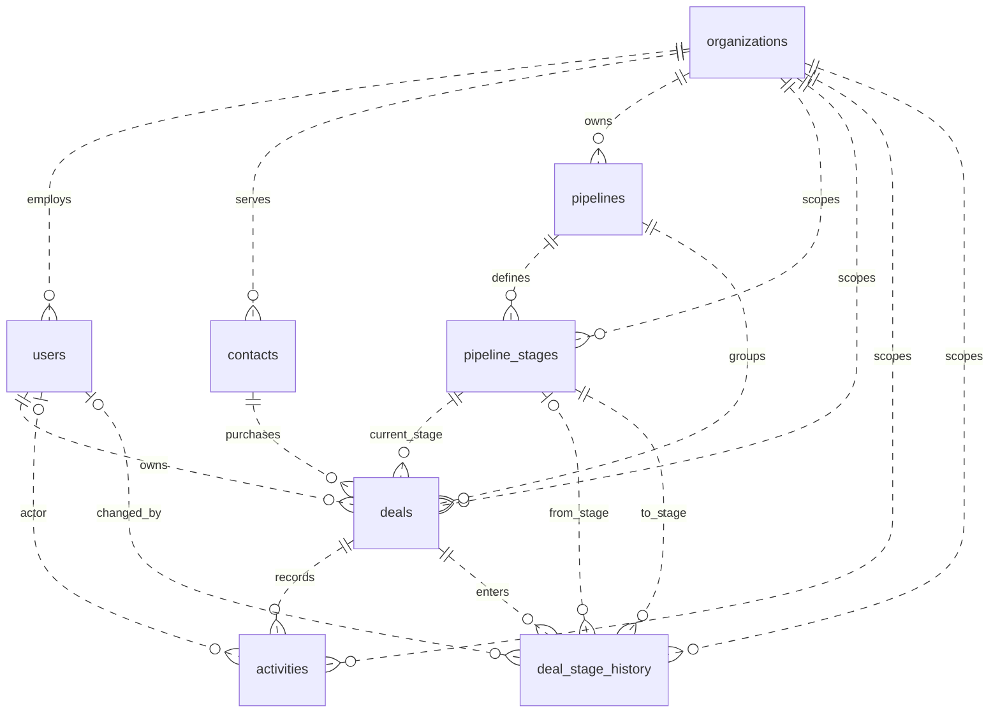

# Модель данных DealMind

**PHASE 1 · DM-101 и DM-102.** Единица анализа — отдельная попытка продать образовательный продукт. У одного клиента могут быть две покупки с разными суммами, владельцами и исходами. В отчёте о сделках это две строки, в списке контактов — один человек. Словарь отражает физическую схему ревизии `0002` и правила будущих прикладных операций. [Решение ADR-0004](adr/0004-crm-domain-model.md) · [Сценарии и критерии](tasks/DM-101.md)

## Фактическая схема PostgreSQL

После `alembic upgrade head` в `public` находятся восемь CRM-таблиц и служебная `alembic_version` со значением `0002`. Базовая ревизия `0001` включает pgvector. На PostgreSQL 17 проверены upgrade с пустой БД и с baseline, откат до baseline и повторный upgrade. Откат `0002 → 0001` удаляет восемь таблиц со всеми строками, сохраняя vector. Историческое состояние стенда PHASE 0 зафиксировано отдельно. [Миграция CRM](../apps/api/alembic/versions/0002_create_crm_schema.py) · [Протокол DM-102](tasks/DM-102.md) · [Измерения PHASE 0](acceptance/evidence.json)

## Предметная область и терминология

| Термин | Смысл для онлайн-школы |
| --- | --- |
| Organization, User | Школа задаёт область данных, календарь и валюту по умолчанию. Пользователь — участник её отдела продаж. Роль классифицирует участника. |
| Contact, Deal | Заявку связывают с человеком, затем заводят возможность продажи и назначают владельца. При повторной покупке используют тот же контакт и новый UUID сделки. |
| Pipeline, PipelineStage | Воронка описывает процесс продаж, этап — именованную позицию в нём. `stage_type` определяет открытый или один из двух финальных исходов. |
| Won Deal, Lost Deal | В первом случае подтверждена коммерческая продажа на положительную сумму, во втором — завершена попытка продажи с известной категорией потери. |
| Activity, Next Action | Активность фиксирует произошедшее событие. `next_action_at` задаёт срок ближайшего плана по открытой сделке. План может существовать до первого контакта. |
| DealStageHistory | Последовательность фактических входов в этапы. Используется для длительности и конверсий. |
| Risk Score | Эвристические баллы по наблюдаемым фактам на заданный момент. Статистическая вероятность проигрыша потребовала бы отдельно проверенной модели. |

## Физическая ER-диаграмма

DM-103 подготовит одну демонстрационную школу и основную воронку. Структура допускает несколько школ и воронок. Отдельная сущность Lead для регистрации первого обращения не требуется.

У каждого дочернего объекта ровно одна организация. Для сделки обязательны один контакт, один владелец, одна воронка и её текущий этап. У новой воронки в процессе настройки могут отсутствовать этапы. Для активации проверяется полная конфигурация. Схема допускает ноль строк истории. Создающий сделку сервис обязан записать первый вход в той же транзакции. Активностей может быть ноль. Автор активности и автор перехода допускают отсутствие внутреннего исполнителя. Исходный этап отсутствует только в первой строке истории.

| Будущая связь | Назначение и этап |
| --- | --- |
| Deal → RiskAssessment | 0…N версионированных оценок риска с опорным временем и фактами, DM-107. |
| Organization → IntegrationEvent → доменная операция | В PHASE 2 организация владеет входящими событиями. Применённое событие может породить переход либо активность. Обработанные повторы и операции без изменения состояния тоже требуют учёта. |
| Deal → AIRecommendation | 0…N рекомендаций на основе фактов сделки и оценок риска в PHASE 4. |
| Organization → KnowledgeDocument | Источники знаний принадлежат школе. В PHASE 3 редакции и фрагменты станут основаниями для ссылок из рекомендаций. Прямой FK из Deal для этого не нужен. |

## Физическая схема и словарь полей

SQL-имена приведены буквально. `!` означает `NOT NULL`, `?` — `NULL`, `PK` — первичный ключ. Во всех таблицах `id` — независимый UUID v4, который формирует backend при создании. Все внешние ключи имеют тип `uuid`. Все моменты времени имеют тип PostgreSQL `timestamptz`. При INSERT сервер задаёт `created_at` и начальное `updated_at` через `statement_timestamp()`. При ORM UPDATE с изменёнными полями SQLAlchemy передаёт ту же SQL-функцию для `updated_at`. Автор прямого SQL UPDATE задаёт время явно. Для прямого INSERT клиент также передаёт UUID. При импорте доменное время создания сделки сохраняется из согласованного источника. Клиенты передают aware datetime. PostgreSQL интерпретирует значение без смещения в часовой зоне соединения. Enum-поля физически хранятся как `varchar(32)` с именованными `CHECK` по закрытым спискам. Ключи и условия составных ссылок заданы в матрице ниже.

### Organization · organizations

| Поле | Тип | Обяз. | Значение |
| --- | --- | --- | --- |
| id | uuid | ! PK | Идентификатор школы |
| name | varchar(200) | ! | Отображаемое название |
| timezone | varchar(64) | ! | IANA-зона бизнес-календаря, в демо Europe/Moscow |
| default_currency | varchar(3) | ! | Код по умолчанию для новых сделок, в демо RUB |
| is_active | boolean | ! | При создании true. Деактивация сохраняет данные |
| created_at | timestamptz | ! | Создание |
| updated_at | timestamptz | ! | Последнее изменение |

### User · users

| Поле | Тип | Обяз. | Значение |
| --- | --- | --- | --- |
| id | uuid | ! PK | Участник |
| organization_id | uuid | ! | Организация |
| full_name | varchar(200) | ! | Имя для отображения |
| email | varchar(254) | ? | Нормализованный рабочий адрес |
| role | varchar(32) | ! | manager, sales_lead, admin |
| is_active | boolean | ! | По умолчанию true. Признак доступности для новых назначений |
| created_at | timestamptz | ! | Создание |
| updated_at | timestamptz | ! | Последнее изменение |

Рабочий email MVP записывается в нижнем регистре с удалением внешних пробелов. Пустое необязательное значение приводится к NULL. Используется единое каноническое ASCII-представление для адресов демо. В одной школе адрес закреплён также за деактивированным пользователем. Роли и идентификация исполнителя не дают полномочий доступа. Учётные данные находятся за границей модели.

### Contact · contacts

| Поле | Тип | Обяз. | Значение |
| --- | --- | --- | --- |
| id | uuid | ! PK | Клиент |
| organization_id | uuid | ! | Организация |
| full_name | varchar(200) | ! | Имя клиента |
| email | varchar(254) | ? | Канал связи |
| phone | varchar(32) | ? | Телефон, сохраняется строкой |
| source_system | varchar(64) | ? | Пространство имён источника |
| external_id | varchar(255) | ? | ID контакта у этого источника |
| created_at | timestamptz | ! | Создание |
| updated_at | timestamptz | ! | Последнее изменение |

У контакта может отсутствовать и email, и телефон. Один адрес или телефон может использоваться несколькими людьми. Поиск возможного совпадения и подтверждённая идентификация клиента — отдельные операции. Автоматическое слияние дублей отложено.

### Pipeline · pipelines

| Поле | Тип | Обяз. | Значение |
| --- | --- | --- | --- |
| id | uuid | ! PK | Воронка |
| organization_id | uuid | ! | Организация |
| name | varchar(150) | ! | Название |
| code | varchar(64) | ! | Стабильный код внутри школы |
| description | text | ? | Пояснение процесса |
| is_active | boolean | ! | Новая конфигурация начинается неактивной |
| created_at | timestamptz | ! | Создание |
| updated_at | timestamptz | ! | Последнее изменение |

### PipelineStage · pipeline_stages

| Поле | Тип | Обяз. | Значение |
| --- | --- | --- | --- |
| id | uuid | ! PK | Постоянная идентичность этапа |
| organization_id | uuid | ! | Организация воронки |
| pipeline_id | uuid | ! | Воронка |
| name | varchar(150) | ! | Изменяемая подпись |
| code | varchar(64) | ! | Стабильный код этапа внутри воронки |
| position | integer | ! | Неотрицательный порядок отображения |
| stage_type | varchar(32) | ! | open, won, lost |
| is_active | boolean | ! | По умолчанию true. Доступность для новых входов |
| created_at | timestamptz | ! | Создание |
| updated_at | timestamptz | ! | Последнее изменение |

| Код демо | Подпись | Позиция | Тип |
| --- | --- | ---: | --- |
| new_lead | Новая заявка | 10 | open |
| contact_established | Контакт установлен | 20 | open |
| qualified | Квалификация | 30 | open |
| consultation | Консультация | 40 | open |
| offer_sent | Предложение отправлено | 50 | open |
| decision_pending | Ожидание решения | 60 | open |
| won | Успешная продажа | 70 | won |
| lost | Сделка потеряна | 80 | lost |

Тип, родитель и код этапа фиксируются при вводе в работу. Переименование и перестановка сохраняют UUID и факты переходов. Для активной воронки обязательны хотя бы один активный open и ровно по одному активному won и lost. Отключение последнего необходимого этапа требует сначала деактивировать воронку либо сохранить корректную конфигурацию одним изменением.

### Deal · deals

| Поле | Тип | Обяз. | Значение |
| --- | --- | --- | --- |
| id | uuid | ! PK | Возможность продажи |
| organization_id | uuid | ! | Школа |
| contact_id | uuid | ! | Единственный контакт сделки |
| owner_id | uuid | ! | Ответственный менеджер |
| pipeline_id | uuid | ! | Воронка, закреплённая при создании |
| stage_id | uuid | ! | Последний фактический этап |
| source_system | varchar(64) | ? | Источник сделки |
| external_id | varchar(255) | ? | ID сделки у источника |
| title | varchar(250) | ! | Название возможности или программы |
| amount | numeric(14,2) | ! | Оценка суммы. В открытой сделке с неизвестной ценой указывается 0 |
| currency | varchar(3) | ! | Код валюты сделки, по умолчанию скопированный из Organization |
| status | varchar(32) | ! | open, won, lost. Значение совпадает с типом текущего этапа |
| loss_reason | varchar(32) | ? | Код, обязательный только для lost |
| created_at | timestamptz | ! | Время возникновения возможности и первого входа на этап |
| updated_at | timestamptz | ! | Последнее изменение строки |
| closed_at | timestamptz | ? | Время финального перехода для won/lost |
| next_action_at | timestamptz | ? | Срок ближайшего действия по открытой сделке |
| last_activity_at | timestamptz | ? | Максимум occurred_at состоявшихся клиентских контактов |

### Activity · activities

| Поле | Тип | Обяз. | Значение |
| --- | --- | --- | --- |
| id | uuid | ! PK | Одна запись о действии |
| organization_id | uuid | ! | Организация сделки |
| deal_id | uuid | ! | Сделка |
| actor_id | uuid | ? | Внутренний исполнитель, когда известен |
| activity_type | varchar(32) | ! | call, message, email, meeting, note, task |
| direction | varchar(32) | ! | inbound, outbound, internal |
| occurred_at | timestamptz | ! | Когда произошло действие |
| summary | text | ? | Краткое содержание |
| metadata | jsonb | ! | Объект дополнительных атрибутов, по умолчанию `{}` |
| created_at | timestamptz | ! | Время регистрации записи |

SQLAlchemy использует атрибут `metadata_` с явным отображением на колонку `metadata`. Каждая новая запись получает собственный словарь через `default=dict`, прямой INSERT получает `{}` от PostgreSQL. При ORM UPDATE присваивайте новый объект, например `activity.metadata_ = {**activity.metadata_, "channel": "email"}`. Вложенные изменения на месте SQLAlchemy автоматически не отслеживает. Это сохраняет служебное `Base.metadata`. Канонический атрибут типа действия — `activity_type` согласно мастер-спецификации.

### DealStageHistory · deal_stage_history

| Поле | Тип | Обяз. | Значение |
| --- | --- | --- | --- |
| id | uuid | ! PK | Идентичность перехода |
| organization_id | uuid | ! | Школа |
| deal_id | uuid | ! | Сделка |
| pipeline_id | uuid | ! | Ключ воронки для проверки обеих ссылок на этапы относительно сделки |
| from_stage_id | uuid | ? | NULL только для первой записи |
| to_stage_id | uuid | ! | Этап, в который вошла сделка |
| changed_by_id | uuid | ? | Внутренний участник, при импорте может отсутствовать |
| sequence_no | integer | ! | Номер перехода внутри сделки, начиная с 1 |
| changed_at | timestamptz | ! | Действительное время входа на этап |
| source_system | varchar(64) | ? | Источник внешнего события |
| source_event_id | varchar(255) | ? | Идентификатор события в этом источнике |
| created_at | timestamptz | ! | Время записи перехода |

`pipeline_id` в истории — единственное дополнительное поле к перечню ТЗ. Согласованность этого значения с Deal и обоими этапами обеспечивают составные FK. Оно не является независимым свойством события.

## Принадлежность организации и внешняя идентичность

Каждая дочерняя таблица имеет обязательный FK `organization_id → organizations.id`. У Organization собственный PK служит границей. Сервис выбирает организацию операции и запрашивает данные в этой области. Составные ссылки обеспечивают целостность также при прямой записи в БД. Проверка будущих прав пользователя остаётся задачей API.

Для Contact и Deal пара `(source_system, external_id)` либо целиком заполнена, либо целиком NULL. `source_system` — стабильный код источника в нижнем регистре. `external_id` и `source_event_id` — непрозрачные регистрозависимые строки, включая ведущие нули. Непустые значения принимаются без внешних пробелов. Например, Contact и Deal одной школы могут оба иметь внешний ID `001` в одном источнике. Две сделки одной школы в этом источнике с таким ID конфликтуют.

## Реализованные ограничения PostgreSQL

Каждая строка словаря с `!` получает `NOT NULL`. Типы, уникальность и ссылки действуют независимо от того, какой клиент выполняет запись. Все FK используют `ON DELETE RESTRICT` и `ON UPDATE RESTRICT`. Сохранение идентичности и организации при редактировании входит в контракт будущего сервиса. FK с RESTRICT защищают уже используемые родительские ключи. У составных FK с необязательной ролью применяется `MATCH SIMPLE`. NULL в actor_id, changed_by_id или from_stage_id освобождает от проверки только соответствующую ссылку. Обязательные ссылки на организацию и сделку проверяются независимо. Перечисленные ниже целевые UQ для FK задаются полными уникальными ограничениями без предиката. [PostgreSQL 17 — ограничения](https://www.postgresql.org/docs/17/ddl-constraints.html)

| Таблица | Ключи и ссылки родитель → дочерняя ссылка | Проверяемая граница |
| --- | --- | --- |
| Все восемь | PK `(id)`. Во всех семи дочерних таблицах FK `organization_id → organizations(id)` | Уникальная внутренняя идентичность, действительная организация |
| users, contacts, pipelines | В каждой UQ `(organization_id, id)` | Родительские ключи для составных ссылок |
| pipeline_stages | FK `(organization_id, pipeline_id) → pipelines(organization_id, id)`. UQ `(organization_id, pipeline_id, id)` и UQ `(organization_id, pipeline_id, id, stage_type)` | Первый целевой ключ нужен истории, второй одновременно проверяет этап и статус Deal |
| deals | FK `(organization_id, contact_id) → contacts(organization_id, id)`, `(organization_id, owner_id) → users(organization_id, id)`, `(organization_id, pipeline_id) → pipelines(organization_id, id)`. FK `(organization_id, pipeline_id, stage_id, status) → pipeline_stages(organization_id, pipeline_id, id, stage_type)` | Существующие UUID из другой школы, чужой воронки и несовместимый статус отклоняются самой БД |
| deals как родитель | UQ `(organization_id, id)` и UQ `(organization_id, pipeline_id, id)` | Явные целевые ключи для Activity и истории |
| activities | FK `(organization_id, deal_id) → deals(organization_id, id)` и `(organization_id, actor_id) → users(organization_id, id)` | Действие и известный автор относятся к одной школе |
| deal_stage_history | FK `(organization_id, pipeline_id, deal_id) → deals(organization_id, pipeline_id, id)`. Два FK `(organization_id, pipeline_id, from_stage_id)` и `(organization_id, pipeline_id, to_stage_id)` → `pipeline_stages(organization_id, pipeline_id, id)`. FK `(organization_id, changed_by_id) → users(organization_id, id)` | Оба конца перехода принадлежат воронке именно этой сделки. Пустой исходный этап или автор допускаются согласно словарю |

| Правило | PostgreSQL | Ответственность сервиса |
| --- | --- | --- |
| Имена и коды | CHECK непустого обрезанного текста для обязательных названий, ФИО и title. Коды воронки, этапа и источника соответствуют `^[a-z][a-z0-9_]*$`. Для заданных внешних ID проверяются длина, непустота и отсутствие внешних пробелов | Валидировать до записи. Для Organization распознавать timezone через IANA ZoneInfo |
| Email участника | CHECK канонического непустого email при наличии, частичный UNIQUE `users(organization_id, email) WHERE email IS NOT NULL` | Проверить формат, нормализовать перед поиском и записью. Адреса и телефоны Contact не уникальны |
| Внешние объекты | В contacts и deals отдельно CHECK `(source_system IS NULL) = (external_id IS NULL)` и частичный UNIQUE `(organization_id, source_system, external_id) WHERE external_id IS NOT NULL` | Повторное создание того же объекта диагностируется в рамках конкретной таблицы |
| Коды и порядок | UNIQUE `pipelines(organization_id, code)`, UNIQUE `pipeline_stages(pipeline_id, code)` и `(pipeline_id, position)`. CHECK `position >= 0` | Редактировать конфигурацию в одной транзакции под блокировкой воронки |
| Конфигурация терминалов | Частичный UNIQUE `pipeline_stages(pipeline_id, stage_type) WHERE stage_type IN ('won','lost')` ограничивает число строк каждого терминального типа одним, включая неактивные | До активации и при изменении активной воронки проверить наличие обоих активных терминалов и минимум одного активного open. При повторном включении терминала используется его прежний UUID |
| Перечисления | CHECK `users.role`, `pipeline_stages.stage_type`, `deals.status`, `activities.activity_type`, `activities.direction` и заполненного `deals.loss_reason` по словарям | Подписи локализуются отдельно от стабильных кодов |
| Деньги и валюта | `numeric(14,2)`, CHECK `amount >= 0 AND amount <> 'NaN'::numeric`, CHECK `status <> 'won' OR amount > 0`. Коды `currency` и `default_currency` соответствуют `^[A-Z]{3}$` | Конечный Decimal в допустимом диапазоне и масштабе. Группировка по валюте |
| Форма сделки | CHECK `(status = 'open') = (closed_at IS NULL)`, `(status = 'lost') = (loss_reason IS NOT NULL)`, `status = 'open' OR next_action_at IS NULL`, `closed_at IS NULL OR closed_at >= created_at` | Одновременно записать текущий этап, исход, время закрытия, причину, очистить план и добавить историю |
| Временные поля | Для таблиц с updated_at CHECK `created_at <= updated_at`. Для activities CHECK `occurred_at <= created_at`, истории `changed_at <= created_at` | При вводе данных проверять хронологию относительно сделки и предыдущего события. Использовать единый момент записи внутри операции |
| Направление и атрибуты действия | CHECK разрешает internal для note/task, а для call/message/email/meeting допускает только inbound либо outbound. CHECK `jsonb_typeof(metadata) = 'object'` | Записывать фактическую коммуникацию и атомарно обновлять last_activity_at |
| Одна позиция истории | UNIQUE `deal_stage_history(deal_id, sequence_no)`, CHECK `sequence_no >= 1`, `(sequence_no = 1) = (from_stage_id IS NULL)` и `from_stage_id IS NULL OR from_stage_id <> to_stage_id` | Непрерывность номеров, первое событие, связь с предыдущим этапом и текущей Deal обеспечить транзакцией |
| Событие источника | CHECK `(source_system IS NULL) = (source_event_id IS NULL)`, частичный UNIQUE `deal_stage_history(organization_id, source_system, source_event_id) WHERE source_event_id IS NOT NULL` | Сверить содержание повтора, вернуть прежний результат или конфликт. Полный журнал входящих событий относится к PHASE 2 |
| Активность участников, допустимость перехода, фиксация полей при закрытии | FK сохраняют исторические ссылки. Строковые CHECK защищают записанное состояние | Проверки живого состояния и сравнение до/после выполняет владелец транзакции. Деактивацию и новое назначение сериализовать блокировкой соответствующей строки |

DM-102 использует существующий `Base.metadata.naming_convention`. Для `CHECK` задаётся смысловое имя правила. Имена составных UQ, FK или индексов, у которых шаблон с первой колонкой дал бы совпадение, задаются явно, например `fk_history_from_stage` и `fk_history_to_stage`. Это особенно важно при нескольких ссылках с ведущей `organization_id`. Для удаления пользователь, воронка или этап сначала деактивируются. История сохраняется. Политику удаления персональных данных предстоит определить до работы с реальными клиентами. [Declarative Base](../apps/api/src/dealmind/db/base.py) · [Транзакционная политика](adr/0002-async-database-access.md)

## Жизненный цикл сделки

Создание разрешено в активной организации, в активной воронке и любом её активном открытом этапе. Для демо начальный этап — `new_lead`. Владелец при назначении — активный User с ролью `manager` в той же организации. Переназначение доступно для открытой сделки. Деактивация менеджера сохраняет его прежние ссылки. Руководитель может передать открытые сделки другому менеджеру. У исторических активностей исполнителем остаётся исходный `actor_id`.

| Из | В | Результат |
| --- | --- | --- |
| open | Другой активный open той же воронки | Переход разрешён вперёд, назад и через несколько позиций. Одна запись о фактическом переходе |
| open | won | Разрешён с любого открытого этапа при положительной сумме. Время перехода становится closed_at, loss_reason и next_action_at получают NULL |
| open | lost | Разрешён с любого открытого этапа при указанном коде потери. Время перехода становится closed_at, next_action_at получает NULL |
| Любой | Тот же UUID этапа | Повтор назначения текущего этапа без изменения коммерческих полей — no-op, новой строки истории нет |
| won или lost | open или иной терминальный этап | Отклонить операцию и сохранить последнюю запись истории |
| Любой | Этап другой воронки | Отклонить. Перенос между воронками отложен |

Закрытие фиксирует `owner_id`, `amount`, `currency` и `closed_at`. Код причины фиксируется вместе с исходом. При повторном обращении тот же Contact получает новую Deal. Для open доступны изменение суммы и переназначение. Смена валюты открытой сделки требует явного одновременного указания суммы в новой валюте. Смена владельца, цены или срока follow-up не создаёт перехода. Закрытые сделки сохраняют ссылку на владельца на момент продажи или потери.

| loss_reason | Когда использовать |
| --- | --- |
| price | Предложение слишком дорого относительно воспринимаемой ценности |
| no_budget | У клиента нет доступного бюджета |
| no_response | Связь прекратилась |
| not_interested | Интерес к покупке утрачен |
| competitor | Выбран другой поставщик |
| timing | Покупка не подходит по времени |
| product_mismatch | Программа не отвечает потребности |
| other | Причина известна, но не входит в перечисленные категории |

## События, история и конкуренция

1. **Создание.** Создать Deal и первую историю одной транзакцией. `sequence_no=1`, `from_stage_id=NULL`, `to_stage_id=deals.stage_id` и `changed_at=deals.created_at`. История и состояние доступны читателю после общего commit.
2. **Изменение.** Сервис DM-105 блокирует Deal для записи (`SELECT … FOR UPDATE`), заново читает состояние и последний номер. Для события источника сначала проверяет уже записанный ключ и возвращает подтверждённый повтор по правилу 4. Только для новой команды проверяет ожидаемый `sequence_no` из состояния, которое прочитал отправитель. Допускается равенство `changed_at` предыдущему событию. При меньшем времени — конфликт хронологии, без изменения состояния. Первый и последующие переходы должны предшествовать регистрации либо совпадать с ней.
3. **Фиксация.** Убедиться, что исходный этап равен текущему. Записать `sequence_no + 1`, оба UUID этапов, автора и время. Обновить Deal, включая все поля закрытия, затем commit. При ошибке любое изменение в операции откатывается. Конкурирующая команда со старой версией получает конфликт и должна перечитать сделку. Уникальный индекс страхует от дублирования номера.
4. **Повтор доставки.** Для внешнего перехода при повторе ключа сравнить сделку, этапы и существенные факты события, включая время и поля закрытия при наличии. Идентичный переход подтверждается без новых записей, даже если сделка уже продвинулась. Повтор с иным содержанием отклоняется. При гонке за внешний ключ проигравшая транзакция откатывается и перечитывает сохранённый результат. Пары `(source_system, external_id)` на сделке для этой цели недостаточно.
5. **Операции без перехода.** Команда с ожидаемым номером и тем же этапом возвращает текущее состояние. Старая команда после следующего перехода отклоняется по номеру. До появления IntegrationEvent нет долговременной квитанции для внешнего no-op. В PHASE 2 журнал входа будет фиксировать такие исходы отдельно от истории этапов. Исправление истории задним числом требует отдельной политики.

Для последовательности `qualified → consultation → qualified` последний вход в `qualified` — третий факт. Прежний интервал остаётся доступным для аналитики. Для открытой сделки длительность этапа равна `as_of − changed_at` последнего фактического входа на этот момент. При равном времени сортировать по `sequence_no`. Закрытие завершает предшествующий открытый интервал. Его длина может быть нулевой.

## Активности и follow-up

Значимый контакт — состоявшийся звонок, сообщение, письмо или встреча с клиентом в направлении inbound/outbound. В демо такая запись всегда означает состоявшееся взаимодействие. `note` фиксирует внутреннюю заметку, `task` — внутренний факт работы. Запланированную будущую коммуникацию представляют сроком `next_action_at`. Неуспешным попыткам потребуется отдельный `outcome` при расширении DM-107 или интеграций.

`activities` — источник фактов. В момент регистрации требуется `deals.created_at ≤ occurred_at ≤ activities.created_at`. Поздно пришедшая коммуникация может быть записана после закрытия, если фактически произошла до него или в момент закрытия. Исторические поля владельца, суммы и закрытия при этом сохраняются. `actor_id=NULL` допускается, например, у входящего сообщения с неизвестным внутренним исполнителем.

Активность и обновление `deals.last_activity_at` фиксируются вместе. Для значимого контакта под блокировкой сделки присваивается более позднее из текущего значения и `occurred_at`, при NULL присваивается `occurred_at`. Для note/task поле сохраняется. Если контактов ещё не было, значение остаётся NULL. Для проверки или перестроения проекции берётся максимум времени подходящих активностей по сделке.

Для открытой сделки при заданном `as_of` значение NULL означает отсутствие плана, `next_action_at > as_of` — будущий срок, равенство — срок наступил, `next_action_at < as_of` — просрочка. Завершение действия само по себе не назначает новый срок. У закрытой сделки план очищается.

## Деньги, время и календарь

- Сумму передают десятичной строкой или Decimal. Отклонять float, бесконечности, NaN, отрицательные значения, сумму свыше `999999999999.99` и значения с ненулевой дробной частью за сотыми **до** записи в `NUMERIC(14,2)`. Лишние завершающие нули допускаются без потери значения. PostgreSQL может округлить значение до масштаба колонки. Ноль у открытой сделки означает отсутствие оценённой стоимости, won требует положительную сумму. [PostgreSQL 17 — точные числа](https://www.postgresql.org/docs/17/datatype-numeric.html)
- Валютный код приводится к трём прописным ASCII-буквам. Соглашение MVP проверяет формат кода. Внешний валютный справочник и курсы отложены. Новая сделка получает явную валюту или копию default_currency школы. Изменение настройки школы сохраняет валюту старых сделок. RUB и EUR образуют раздельные денежные итоги.
- API принимает ISO 8601 с явным смещением, Python использует aware datetime, соединения и выдача работают в UTC. Календарный отчёт строится по именованной IANA-зоне школы. Для местного дня вычислить начало дня и начало следующего дня в этой зоне, обе границы перевести в UTC и применить `[start, end)`. В Europe/Moscow местный день 1 июня 2026 года соответствует `[2026-05-31T21:00:00Z, 2026-06-01T21:00:00Z)`. Зону следует применять к обеим границам независимо при сезонном переводе часов.

## Индексы и запросы

PK, полные UQ и частичные уникальные индексы из матрицы обязательны для целостности. Ревизия `0002` создаёт девять обычных индексов для запросов ниже и пять частичных уникальных индексов из матрицы. Ещё 19 индексов PostgreSQL создаёт для PK и полных UNIQUE. В DM-104/106 планы запросов проверят на данных DM-103. Ведущая организация у запросов списка соответствует обязательному фильтру школы. Если индекс для FK/UQ уже покрывает запрос своим левым префиксом, второй индекс для того же порядка избыточен.

| Таблица и ключ | Запрос |
| --- | --- |
| deals (organization_id, status) | Число открытых/закрытых сделок и отбор по статусу внутри школы |
| deals (organization_id, owner_id, status) | Список текущего менеджера с фильтром статуса |
| deals (organization_id, stage_id) | Текущий остаток на выбранном этапе |
| deals (organization_id, created_at) | Новые сделки в полуоткрытом периоде |
| deals (organization_id, closed_at) WHERE closed_at IS NOT NULL | Продажи и потери за период закрытия |
| deals (organization_id, next_action_at) WHERE status='open' AND next_action_at IS NOT NULL | Очередь ближайших и просроченных действий |
| activities (deal_id, occurred_at) | Хронология касаний одной сделки |
| activities (organization_id, actor_id, occurred_at) | Фактические действия исполнителя за период |
| deal_stage_history (deal_id, sequence_no) | Последний или предшествующий переход. Используется уже обязательный UNIQUE, включая обратный обход |
| deal_stage_history (deal_id, changed_at, sequence_no) | Граница интервала и последний этап на as_of с разрешением равных времён |

## Входы Sales Analytics · DM-106

Все запросы ограничены организацией. `as_of` — воспроизводимый опорный момент. Для снимка текущего состояния читают актуальную Deal. Для отчёта на прошлую дату берут только факты, относящиеся к выбранному моменту. Если требуется «что было известно тогда», дополнительно ограничивают время регистрации. Для исторической активности агрегируют подходящие строки activities по occurred_at.

| Показатель | Источник, отбор и единица наблюдения |
| --- | --- |
| Новые сделки | Число Deal с created_at в периоде |
| Активные сделки | Число текущих Deal со status=open. Число открытых на прошлую дату восстанавливается из первоначальных и терминальных переходов |
| Выигранные и проигранные | Число won и lost отдельно по closed_at в периоде |
| Сумма открытой воронки | Сумма amount текущих open по currency. Нулевая оценка входит в количество, вклад в сумму равен нулю |
| Выигранная выручка | Сумма amount выигранных по closed_at, отдельно по currency. Показатель отражает стоимость сделок. Платежи, рассрочки, возвраты и бухгалтерское признание в данных отсутствуют |
| Win rate | В когорте закрытых за период доля равна won / (won + lost). Нулевой знаменатель даёт неопределённый результат. Когорту по созданию следует маркировать отдельно |
| Конверсия этапов | По посещениям из истории и distinct deal_id в воронке. Различать реальный вход и пропуск, задавать порядок A → B по sequence_no, учитывать возвраты. DM-106 выбирает горизонт и знаменатель |
| Средний чек | Сумма won / число won внутри одной валюты и когорты закрытия |
| Средняя длительность цикла | Для выбранной когорты закрытых — интервал closed_at − created_at. Срез только успешных продаж обозначается отдельно |
| Результаты менеджера | Текущий owner_id для открытой воронки и зафиксированный при закрытии owner_id для won/lost |
| Активность менеджера | По actor_id и occurred_at, с разбивкой по activity_type/direction. Отсутствующий actor_id относится к неатрибутированным фактам |
| Просроченные follow-up | По текущему состоянию open и next_action_at строго раньше as_of. NULL и точное равенство имеют отдельные значения |
| Причины потерь | Число lost в когорте closed_at по стабильному loss_reason |
| Время на этапе | Один интервал на каждый вход, конец по следующему переходу или as_of. Повторные входы учитываются отдельно |

Полная история цены, валюты, владельца и назначений follow-up в MVP отсутствует. Для прошлой даты доступны этап, посещения и длительность. Сумму и владельца открытой воронки, её тогдашнюю просрочку и риск по всем признакам нельзя точно восстановить из их последних значений. Код и UUID этапа устойчивы, исторический текст его подписи отдельно не версионируется.

## Входы Risk Engine · DM-107

Оценивать открытые сделки на явно заданный `as_of`. Начальная шкала из мастер-спецификации даёт low 0–29, medium 30–59, high 60–100. Суммарный балл ограничен 100. У закрытых сделок предупреждений открытой воронки нет. [Правила продукта](MASTER_SPEC.md)

| Основание | Баллы | Какой факт потребуется |
| --- | ---: | --- |
| Более 72 часов без состоявшегося контакта | +35 | as_of − last_activity_at. Если контактов не было, использовать created_at и явно отметить основание «с момента создания» |
| Следующее действие отсутствует | +25 | next_action_at IS NULL |
| Срок следующего действия превышен | +30 | next_action_at задан и строго раньше as_of. С предыдущим правилом взаимоисключающе |
| Более 14 суток на текущем этапе | +20 | Время последнего входа из истории, включая возврат, и as_of. Длительность не зависит от updated_at |

Ровно 72 часа, 14 суток и точное совпадение срока с as_of не удовлетворяют строгому «более»/«раньше». Проверка границ и версия правил закрепляются в DM-107. При отсутствии обязательной истории нужно зафиксировать ошибку качества данных. Итог, `scoring_version`, время оценки и подтверждающие факты предполагается сохранять отдельно в RiskAssessment.

## Синтетические данные · DM-103

Один фиксированный seed и одна anchor date определяют воспроизводимый набор одной школы Europe/Moscow с основной воронкой, 5–10 менеджерами, одним руководителем и 500–1000 сделок. Основная валюта — RUB. Для валютного теста предусмотреть отдельные примеры в EUR. Названия нескольких образовательных программ входят в title. Персональные сведения создаются искусственно.

В набор входят все три исхода, восемь причин потери, разные суммы, повторная покупка одного Contact, движение вперёд, возврат и пропуск этапа, открытая сделка без взаимодействий, просроченная, без плана и с долгим пребыванием на этапе. Нужны также внутренняя заметка и поздно записанный контакт. Интервалы и сценарии должны выводиться из значений полей и согласованной истории. Частоты генератора задают тестовое покрытие. Для вывода о реальных продажах школы нужны отдельные наблюдения.

## Граница реализации и отложенные решения

- **DM-102 завершена.** Восемь ORM-моделей, миграция `0002` и ограничения проверены на отдельной PostgreSQL. [Результаты и количественная сверка схемы](tasks/DM-102.md)
- **DM-103–105.** Создание датасета, HTTP-контракты CRM, конкурентные переходы, повтор доставки и синхронизация производных полей имеют отдельные задачи. Тестовые примеры первой миграции могут наполнять согласованную историю непосредственно внутри своей транзакции.
- **DM-106/107.** Финальные когорты и знаменатели, версия скоринга и его объяснение, а также необходимость атрибута результата попытки связи. Аналитика по продуктам потребует отдельного решения о структурированном товаре до генерации соответствующих данных.
- **PHASE 2 и далее.** Общий журнал IntegrationEvent, политика исторических коррекций, авторизация, хранение знаний и разрешение внешних действий проектируются со своими потребителями. Для межвороночного переноса или reopening потребуется новое решение о цепочке переходов и метриках.
