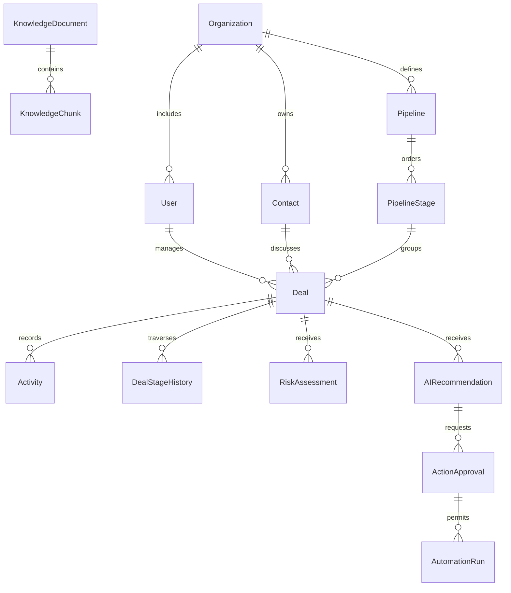

# Модель данных DealMind

## Что существует в PostgreSQL

Миграция Alembic `0001` включает расширение `vector` с `CREATE EXTENSION IF NOT EXISTS`. В Compose расширение также создаётся init-скриптом при первом запуске на пустом томе. На проверенном стенде в схеме `public` единственная таблица — `alembic_version` с ревизией `0001`, версия pgvector — `0.8.7`. Возможность вычислить векторное расстояние уже есть. Индексы знаний и прикладные таблицы появятся с соответствующими миграциями. n8n хранит собственную SQLite отдельно. [Baseline](../apps/api/alembic/versions) · [Проверка схемы](RUNBOOK.md)

## Предварительная модель PHASE 1 и последующих этапов

| Сущности | Назначение |
| --- | --- |
| Organization, User | Граница организации и участник, которому можно назначить сделку или действие |
| Pipeline, PipelineStage | Воронка и её именованные этапы |
| Contact, Deal | Клиент и отдельная возможность продажи образовательного продукта |
| Activity, DealStageHistory | Касание или задача и история переходов, необходимая для расчёта времени и конверсии |
| IntegrationEvent | Приём входящего события, ключ идемпотентности и результат обработки |
| RiskAssessment | Оценка, версия детерминированного правила, факты и время расчёта |
| KnowledgeDocument, KnowledgeChunk | Редакция документа и адресуемый фрагмент для retrieval и цитирования |
| AIRecommendation, ActionApproval | Версия рекомендации и решение человека о конкретном действии |
| AutomationRun, AuditLog | Попытка исполнения разрешённой операции и журнал значимых решений |

**Planned domain model.** Кардинальности на схеме — рабочая гипотеза для обсуждения в DM-101. В частности, обязательность контакта и правила смены владельца ещё открыты.

### Поля для проектирования DM-101

| Сущность | Предлагаемые поля |
| --- | --- |
| Deal · идентификация | `id`, `organization_id`, `external_id`, `source_system` |
| Deal · связи | `contact_id`, `owner_id`, `pipeline_id`, `stage_id` |
| Deal · состояние | `title`, `amount`, `currency`, `status` |
| Deal · время | `created_at`, `updated_at`, `closed_at`, `next_action_at`, `last_activity_at` |
| Activity | `id`, `organization_id`, `deal_id`, `actor_id`, `type`, `direction`, `occurred_at`, `summary`, `metadata` |

Кандидаты для `Activity.type` — call, message, email, meeting, note, task. При моделировании нужны UUID, время в UTC, внешние ключи и ограничения уникальности. Денежная сумма представляется Decimal/NUMERIC с отдельной валютой. Ключ внешнего объекта включает организацию, источник и внешний ID. Для доставки события нужен отдельный устойчивый event ID и атомарная запись результата с изменением состояния. История этапов сохраняет прошлые переходы. Для fixtures и портфолио используются синтетические данные. Изоляция организаций входит в будущее проектирование доступа.

### Метрики и открытые решения

Планируются новые, активные, выигранные и проигранные сделки, сумма открытой воронки, выигранная выручка, конверсия этапов, средний чек и цикл, активность менеджеров, просроченные касания, распределение риска и причины потерь. Для каждого показателя DM-106 определит событие отсечения, интервал, когорту, знаменатель, валюту и учёт исторических переходов.

До DM-101/106 предстоит определить разрешённые переходы, reopening закрытой сделки, момент признания выручки, повторные продажи, конвертацию валют, историю назначения менеджера и изменения суммы, справочник причин проигрыша и бизнес-часовой пояс отчётности. [Roadmap](ROADMAP.md)
