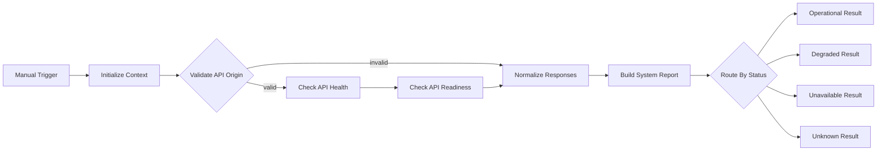

# DM-009 · n8n Integration Bootstrap & System Health Check

## 1. Summary

**Task ID** — DM-009. **Status** — DONE. **Phase** — Project Foundation. **Priority** — P0. Приёмка выполнена 24 ноября 2026 года. Исходная ветка `dev`, коммит `1bd8815`. **Dependencies** — принятые DM-001…DM-008.

**Objective и Scope.** Оператор вручную получает один диагностический отчёт о FastAPI и PostgreSQL с привязкой к HTTP-журналам. Поставка включает граф n8n, проверенный переносимый JSON, четыре примера, статический валидатор, руководство, испытания реальных отказов и историю запусков.

**Out of Scope.** Расписания, CRM webhooks, Telegram, AI/RAG, доменные записи, CI и публичное развёртывание относятся к следующим этапам.

## 2. n8n Environment

Рабочая версия — **2.48.8** по `n8n --version`. Образ — `n8nio/n8n:2.48.8@sha256:e0df076a41076127d5f765e05acb8ba746bddff86442a92269c0f5a7219a7e4b`. Встроенная SQLite расположена в томе `dealmind_n8n_data` по пути `/home/node/.n8n`. Сервер и CLI используют штатную модель идентификаторов и проектов n8n.

Основной редактор вернул HTTP 200 на `127.0.0.1:5679`. На основном экземпляре остаётся штатный мастер создания владельца. Пользователь разрешил временную учётную запись только для отдельного тестового n8n. Там проверены вход, граф, исполнение, узлы, JSON и история. Импорт и запуск на основном экземпляре выполнены поддерживаемым локальным Server CLI.

Из основного n8n получены `GET http://api:8000/api/v1/health` и `GET http://api:8000/api/v1/ready`. Оба ответили 200, Content-Type application/json. Два пути сверены с OpenAPI. Readiness FastAPI проверяет PostgreSQL. Учетные данные для этих HTTP-запросов не нужны.

## 3. Workflow Architecture



HTTP-узлы используют доверенную конфигурацию Initialize Context. Оба сохраняют статус, заголовки и текст тела для валидации. Normalize Responses читает результаты отдельно по именам. Установка неверного origin ведёт сразу в нормализацию. Итоговый item содержит только ограниченный набор полей. Две Sticky Notes поясняют повторы и чтение отчёта.

## 4. Nodes

| Узел | Тип и версия | Результат |
| --- | --- | --- |
| Manual Trigger | Manual Trigger 1 | Один ручной запуск |
| Initialize Context | Edit Fields 3.5 | Версия, execution ID, время UTC, origin |
| Validate API Origin | Switch 3.5 | Выбирает HTTP-путь или обработку ошибки конфигурации |
| Check API Health | HTTP Request 4.5 | Health, полный HTTP-ответ либо транспортная ошибка |
| Check API Readiness | HTTP Request 4.5 | Readiness независимо от результата health |
| Normalize Responses | Code 2 | Валидированные метаданные двух проб и состояние проверок |
| Build System Report | Code 2 | Время завершения, длительность, диагностический статус и массив ошибок |
| Route By Status | Switch 3.5 | Один из четырёх выходов по overall_status |
| Operational Result | No Operation 1 | Один подтверждённый operational item |
| Degraded Result | No Operation 1 | Один item при частичном отказе |
| Unavailable Result | No Operation 1 | Один item при недоступности API |
| Unknown Result | No Operation 1 | Один item с неподтверждённым состоянием |
| Transport policy, Diagnostic outcome | Sticky Note 1 | Пояснения на canvas, в исполнении не участвуют |

Типы и версии взяты из установленного образа. Контракт двух FastAPI routes, правила выбора статуса и назначения полей подробно описаны в карточке интеграции. [Workflow 1.0.0](../../automations/n8n/workflows/system-health-check.md)

## 5. Workflow Execution · Output Contract

Результат после обычного перезапуска основного n8n. Указан внутренний ID исполнения, времена и UUID, полученные именно в этом запросе.

```json
{
  "schema_version": "1.0",
  "workflow": "system-health-check",
  "workflow_version": "1.0.0",
  "execution_id": "1",
  "started_at": "2026-11-24T18:02:44.356Z",
  "finished_at": "2026-11-24T18:02:46.006Z",
  "duration_ms": 1650,
  "overall_status": "operational",
  "services": {
    "backend": {
      "status": "operational",
      "http_status": 200,
      "request_id": "f994f5c3-1f81-4c76-ae8a-d73bcf0ed858"
    },
    "readiness": {
      "status": "operational",
      "http_status": 200,
      "request_id": "e4277922-97e9-4383-9e23-b8ba578eee5e"
    },
    "database": {
      "status": "operational"
    }
  },
  "errors": []
}
```

## 6. Error Scenarios · Error Handling и Retry Policy

Тестовый n8n с отдельной учётной записью и томом обращался к копии FastAPI и отдельной PostgreSQL в изолированной Docker-сети. Сценарии некорректного HTTP и таймаутов использовали временную заглушку вместо тестового API. Неисправности не вносились в основной стек. В таблице приведены фактически сохранённые результаты ручных исполнений тестового экземпляра.

| Сценарий | Execution ID | Health / ready HTTP | Overall | Database | Коды ошибок | Длительность отчёта, мс |
| --- | ---: | --- | --- | --- | --- | ---: |
| Первый запуск в Editor | 1 | 200 / 200 | operational | operational | — | 912 |
| Остановлена отдельная PostgreSQL | 2 | 200 / 503 | degraded | not_ready | DATABASE_NOT_READY | 4105 |
| БД снова запущена | 3 | 200 / 200 | operational | operational | — | 56 |
| Остановлен отдельный FastAPI | 4 | null / null | unavailable | unknown | NETWORK_ERROR, NETWORK_ERROR | 22120 |
| API снова запущен | 5 | 200 / 200 | operational | operational | — | 63 |
| Невалидный JSON health и неполная схема ready | 6 | 200 / 200 | unknown | unknown | INVALID_RESPONSE, INVALID_RESPONSE | 143 |
| HTTP 404 и 500 | 7 | 404 / 500 | unknown | unknown | HTTP_ERROR, HTTP_ERROR | 46 |
| 503 при незавершённом startup | 8 | 200 / 503 | degraded | unknown | APPLICATION_NOT_READY | 63 |
| Сброс соединения health | 9 | null / 200 | degraded | operational | NETWORK_ERROR | 1122 |
| Задержка health свыше 8 с | 10 | null / 200 | degraded | operational | TIMEOUT | 17061 |
| Повторный импорт из CLI-экспорта | 11 | 200 / 200 | operational | operational | — | 182 |
| Некорректный origin в тестовой копии | 13 | null / null | unknown | unknown | CONFIGURATION_ERROR, CONFIGURATION_ERROR | 21 |
| Задержка readiness свыше 8 с | 14 | 200 / null | degraded | unknown | TIMEOUT | 17127 |
| Импорт из файла в Editor и Execute | 15 | 200 / 200 | operational | operational | — | 68 |

Контрольное исполнение **№12** отдельной тестовой копии завершилось со статусом **error** на Build System Report после намеренного исключения. В основной workflow такая проверка не вносилась. Для диагностических отказов штатного графа n8n сохранил успешное завершение с соответствующим overall_status.

Счётчики запросов из журнала HTTP-заглушки подтверждают фактическую семантику Max Tries. Значения ниже — количество полученных запросов health / readiness.

| Сценарий | Запросы | Интервал между началами двух попыток одного пути |
| --- | --- | --- |
| Повреждённое тело и неполная схема | 1 / 1 | — |
| HTTP 404 / 500 | 1 / 1 | — |
| Валидный HTTP 503 | 1 / 1 | — |
| Сброс соединения health | 2 / 1 | 1026 мс |
| Таймаут health | 2 / 1 | 9007 мс |
| Таймаут readiness | 1 / 2 | 9008 мс |

Каждая попытка ограничена 8000 мс, ожидание перед повтором — 1000 мс, лимит workflow — 60 с. Ошибки HTTP и JSON проверяются после получения ответа. Граф не создаёт цикл. Успешный ответ второго endpoint сохраняется при отказе первого и наоборот.

## 7. Request ID Correlation

В журнале основного FastAPI найдены события HTTP с точным совпадением трёх полей отчёта.

| Проба | Request ID | http_route | status_code |
| --- | --- | --- | ---: |
| Health | `f994f5c3-1f81-4c76-ae8a-d73bcf0ed858` | `/api/v1/health` | 200 |
| Readiness | `e4277922-97e9-4383-9e23-b8ba578eee5e` | `/api/v1/ready` | 200 |

Execution ID **1** относится к основному n8n. В отдельном тестовом n8n последовательность ID началась заново. UTC timestamp и request IDs позволяют однозначно найти HTTP-события для конкретного экземпляра.

## 8. Export & Import

Рабочий граф имеет логический ID `system-health-check` и версию 1.0.0. В основном экземпляре он сохранён как черновик с внутренним ID `poS7JI18bTLN3f4N`. Из основного n8n экспортирован только этот ID. У переносимого объекта оставлены name, nodes, connections, active и settings. Получившийся JSON побайтно совпал с файлом репозитория после одинаковой сериализации.

Тестовый CLI назначил повторно импортированной копии отдельный ID и выполнил её (№11). Дополнительно проверен путь редактора ⋯ → Import → From file → Skip → Execute (№15). Все встроенные узлы распознаны. Сравнение перед повторным импортом защищает от накопления одноимённых копий. [Переносимый JSON](../../automations/n8n/workflows/system-health-check.json)

## 9. Test Results · Test Strategy

Статические проверки выполнялись без Docker через Python. Динамические проверки выполнялись в n8n 2.48.8 на настоящем FastAPI и контролируемом HTTP-стенде. История редактора подтверждает режим manual, конечный узел и количество items.

| ID | Проверка | Результат | Основание |
| --- | --- | --- | --- |
| TC-001 | JSON Validity | PASS | JSON прочитан стандартным парсером Python и импортёром n8n |
| TC-002 | Required Structure | PASS | name, nodes, connections, settings проверены |
| TC-003 | Node References | PASS | Все рёбра существуют, ориентированный граф ацикличен |
| TC-004 | Unique Node Names | PASS | Проверены имена и ID узлов |
| TC-005 | Manual Trigger | PASS | Один Manual Trigger, в истории mode=manual |
| TC-006 | No Secrets | PASS | Проверены ключи, URL, authentication, значения секретов и JS |
| TC-007 | No Pinned Data | PASS | pinData отсутствует, уникальные Request IDs в повторных запусках |
| TC-008 | Fixed API Destinations | PASS | Один доверенный origin, два GET, redirect выключен |
| TC-009 | Bounded Retry | PASS | Две попытки при reset и timeout (§6) |
| TC-010 | Example Contracts | PASS | Четыре полных отчёта прошли валидатор |
| TC-011 | Workflow Import | PASS | CLI и редактор 2.48.8 приняли один переносимый JSON |
| TC-012 | Manual Execution | PASS | Ручные запуски в авторизованном Editor, включая №15 |
| TC-013 | Health Request | PASS | Основной №1 и тестовый №1 — HTTP 200 |
| TC-014 | Readiness Request | PASS | Основной №1 и тестовый №1 — HTTP 200 |
| TC-015 | Operational Result | PASS | Оба ID найдены в логах, общий статус operational |
| TC-016 | Database Unavailable | PASS | Изолированный №2 — 200/503, database=not_ready |
| TC-017 | HTTP 503 Handling | PASS | №2 завершился успешно в ветке Degraded Result. В тесте №8 у 503 была одна попытка |
| TC-018 | Backend Unavailable | PASS | №4, оба HTTP-кода null, два NETWORK_ERROR, database=unknown |
| TC-019 | Timeout | PASS | №10 и №14, задержанный endpoint запрошен дважды |
| TC-020 | Invalid JSON | PASS | №6, тело health было невалидным JSON, HTTP 200 сохранён |
| TC-021 | Invalid Response Schema | PASS | №6, у readiness отсутствовали checks |
| TC-022 | Unexpected HTTP Status | PASS | №7, health 404 и ready 500, обе пробы без повторов |
| TC-023 | Partial Result | PASS | №9 и №10 сохранили readiness после ошибки health, №14 сохранил health при таймауте readiness |
| TC-024 | Request ID Extraction | PASS | UUID v4 в основном отчёте (§5) |
| TC-025 | Backend Log Correlation | PASS | Два события FastAPI, проверены UUID, маршрут и 200 (§7) |
| TC-026 | Execution Context | PASS | ID истории совпадает с execution_id, duration_ms равна разности двух UTC timestamp |
| TC-027 | Recovery | PASS | №3 и №5 после старта БД и API вернули operational |
| TC-028 | Repeated Execution | PASS | Ручные повторные GET: №1, 3, 5 и 11, уникальные ID, ноль операций записи в доменные данные |
| TC-029 | Persistence | PASS | ID основного workflow сохранился после docker compose restart n8n, затем он выполнился |
| TC-030 | Reimport | PASS | Экспорт основного экземпляра импортирован отдельно, тест №11 и UI-импорт №15 успешны |
| TC-031 | Single Final Result | PASS | В каждом диагностическом запуске по истории проверен один item и один исполненный конечный узел |

## 10. Regression Results · Verification Results

| Команда | Фактический результат |
| --- | --- |
| `uv lock --check` | PASS, 41 пакет |
| `uv run --locked ruff check .` | PASS |
| `uv run --locked ruff format --check .` | PASS, 46 файлов |
| `uv run --locked mypy src tests` | PASS, 43 исходных файла |
| `uv run --locked pytest -m "not database"` | 63 passed, 4 deselected по маркеру. Прежнее предупреждение Starlette о TestClient и httpx |
| `npm run lint` / `npm run typecheck` | PASS / PASS |
| `npm run test` | 29 passed в двух файлах |
| `npm run build` | PASS, Next.js 16.4.6, standalone и статические assets |
| `python scripts/validate_n8n_workflow.py` | PASS, граф и четыре примера |
| `docker compose config --quiet` | PASS |
| `bash scripts/smoke_infra.sh` | PASS для HTTP, Swagger/OpenAPI, PostgreSQL, pgvector, n8n и внутреннего DNS |
| Web System Overview | HTML страницы содержит System Overview, `/api/system/status` вернул operational |

Фактические сервисы после испытаний

```text
SERVICE   STATUS                   PORTS
api       Up 7 hours (healthy)     127.0.0.1:8001->8000/tcp
db        Up 10 hours (healthy)    127.0.0.1:5433->5432/tcp
n8n       Up 7 minutes (healthy)   127.0.0.1:5679->5678/tcp
web       Up 6 hours (healthy)     127.0.0.1:3000->3000/tcp
```

## 11. Acceptance Criteria

| ID | Критерий | Статус | Основание |
| --- | --- | --- | --- |
| AC-01 | Существующий репозиторий изучен. | PASS | §1, ветка dev |
| AC-02 | n8n version подтверждена. | PASS | CLI, §2 |
| AC-03 | n8n container работает. | PASS | Compose, §10 |
| AC-04 | n8n UI доступен. | PASS | Editor HTTP 200, тестовый вход и canvas |
| AC-05 | n8n может обращаться к FastAPI через Docker network. | PASS | Два живых GET из основного n8n |
| AC-06 | Создан System Health Check workflow. | PASS | §3 и экспорт |
| AC-07 | Используется Manual Trigger. | PASS | TC-005/012 |
| AC-08 | Execution context формируется. | PASS | TC-026 |
| AC-09 | Execution ID получается из n8n. | PASS | TC-026 |
| AC-10 | Health Request выполняется. | PASS | TC-013 |
| AC-11 | Readiness Request выполняется. | PASS | TC-014 |
| AC-12 | HTTP status codes сохраняются. | PASS | №2, 6, 7 |
| AC-13 | Response headers доступны. | PASS | Два HTTP Request с fullResponse, TC-024 |
| AC-14 | Response normalization реализована. | PASS | Normalize Responses |
| AC-15 | JSON contracts валидируются. | PASS | TC-020/021 |
| AC-16 | Результаты обоих запросов сохраняются независимо. | PASS | TC-023 |
| AC-17 | Operational state работает. | PASS | №1 |
| AC-18 | Degraded state работает. | PASS | №2 |
| AC-19 | Unavailable state работает. | PASS | №4 |
| AC-20 | Unknown state работает. | PASS | №6 |
| AC-21 | HTTP 503 readiness обрабатывается корректно. | PASS | №2/8 |
| AC-22 | Недоступность API не подменяется ложным статусом БД. | PASS | №4 и №14 |
| AC-23 | Invalid JSON не считается успешным ответом. | PASS | №6 |
| AC-24 | Conditional branching реализован. | PASS | Route By Status, четыре выполненных выхода |
| AC-25 | Network errors обрабатываются. | PASS | №4/9 |
| AC-26 | Timeout настроен. | PASS | №10/14 |
| AC-27 | Retry ограничен. | PASS | TC-009 и счётчики §6 |
| AC-28 | Нет бесконечных циклов. | PASS | TC-003, executionTimeout=60 |
| AC-29 | Ожидаемые диагностические ошибки не уничтожают итоговый результат. | PASS | TC-016…023 |
| AC-30 | Неожиданные ошибки самого workflow не скрываются. | PASS | Контрольная ошибка кода №12 |
| AC-31 | Health Request ID извлекается. | PASS | TC-024 |
| AC-32 | Readiness Request ID извлекается. | PASS | TC-024 |
| AC-33 | Request IDs найдены в backend logs. | PASS | TC-025 |
| AC-34 | UTC timestamps формируются фактически. | PASS | TC-026 |
| AC-35 | Duration отражает реальное время выполнения. | PASS | TC-026 |
| AC-36 | Execution history доступна. | PASS | Тестовый Editor → Executions, сохранены входы и выходы |
| AC-37 | Итоговый structured report соответствует контракту. | PASS | TC-010/031 |
| AC-38 | Workflow экспортирован в JSON. | PASS | CLI export:workflow одного ID |
| AC-39 | JSON находится в automations/n8n/workflows. | PASS | §8 |
| AC-40 | JSON валиден. | PASS | TC-001 |
| AC-41 | Connections корректны. | PASS | TC-003 |
| AC-42 | Нет ненужных pinned data. | PASS | TC-007 |
| AC-43 | Workflow не содержит секретов. | PASS | TC-006, §12 |
| AC-44 | Workflow успешно импортируется. | PASS | TC-011 |
| AC-45 | Импортированный workflow выполняется. | PASS | №11 и №15 |
| AC-46 | JSON examples соответствуют контракту. | PASS | TC-010 |
| AC-47 | Успешный реальный execution проверен. | PASS | TC-012…015 |
| AC-48 | Недоступность тестовой БД проверена. | PASS | TC-016 |
| AC-49 | Недоступность тестового API проверена. | PASS | TC-018 |
| AC-50 | Timeout scenario проверен. | PASS | TC-019 |
| AC-51 | Invalid response scenario проверен. | PASS | TC-020/021 |
| AC-52 | Recovery scenario проверен. | PASS | TC-027 |
| AC-53 | Repeated execution безопасен. | PASS | TC-028 |
| AC-54 | Workflow persistence проверена. | PASS | TC-029 |
| AC-55 | Backend regression tests проходят. | PASS | §10, backend |
| AC-56 | Frontend quality checks проходят. | PASS | §10, frontend |
| AC-57 | Нет прямого SQL-доступа из n8n. | PASS | TC-008, типы узлов |
| AC-58 | Не созданы публичные webhooks. | PASS | Только ручной триггер |
| AC-59 | Не отключена n8n authentication. | PASS | Существующая авторизация, стандартный onboarding тестового владельца |
| AC-60 | Не изменён encryption key. | PASS | Нулевой diff конфигурации, сохранён основной том |
| AC-61 | Основные Docker volumes сохранены. | PASS | Проверены оба именованных тома |
| AC-62 | Не реализованы CRM workflows раньше времени. | PASS | §1, scope |
| AC-63 | Пользовательские изменения сохранены. | PASS | Изначально чистая dev, §16 |
| AC-64 | n8n README актуализирован. | PASS | Руководство n8n |
| AC-65 | Workflow registry создан. | PASS | Реестр в README n8n |
| AC-66 | system-health-check.md создан. | PASS | Карточка workflow |
| AC-67 | Root README обновлён. | PASS | README.md |
| AC-68 | PROJECT_CONTEXT обновлён. | PASS | PROJECT_CONTEXT.md |
| AC-69 | ARCHITECTURE обновлён. | PASS | ARCHITECTURE.md |
| AC-70 | DM-009.md создан. | PASS | Данный документ |
| AC-71 | ROADMAP актуализирован. | PASS | DM-009 DONE, DM-010 READY |
| AC-72 | Проект готов к DM-010. | PASS | §17–18 |

## 12. Security Review

В экспорт попали только встроенные узлы и две фиксированные GET-операции. Перенаправления отключены. Код обрабатывает диагностические данные без доступа к оболочке, файловой системе, Docker socket, SQL или внешним пакетам. Отчёт содержит HTTP-коды, отдельные UUID и нормализованные сообщения. Raw stack, headers, body и внутренний origin в публичные поля отчёта не переносятся. Сохранение истории настроено на уровне одного workflow.

Export проверен на credentials, ключи, cookies, Authorization, pinData, ownership и значения секретов из локального окружения. Глобальные настройки доступа, ключ шифрования, Compose и `.env.example` сохраняют исходную конфигурацию. Основные тома `dealmind_n8n_data` и `dealmind_postgres_data` присутствуют. После приёмки тестовые контейнеры остановлены и убраны вместе с тестовой сетью. Отдельный том `dm009-bec0e0ad60-n8n-data` с историей тестов сохранён. Временная авторизованная сессия браузера удалена.

## 13. Changed Files

Полный перечень путей и их Git-статусов приведён в §16. Реализация состоит из переносимого workflow, карточки запуска, четырёх JSON-отчётов, статической проверки, четырёх скриншотов и обновлений документации. Существующая архитектура интеграций описана в ADR-0001. Выбранный HTTP-паттерн укладывается в это решение.

## 14. Screenshots

Снимки сделаны в работающем редакторе отдельного тестового экземпляра. На экране деградации видны Succeeded для выполнения и фактически пройденная ветка Degraded Result для системы.

[Workflow canvas](../assets/dm009-workflow.png) · [Успешное исполнение №1](../assets/dm009-successful-execution.png) · [Итоговый JSON №1](../assets/dm009-output.png) · [Деградация при остановке БД, №2](../assets/dm009-degraded-execution.png)

## 15. Known Limitations

Диагностика запускается вручную и характеризует интервал двух последовательных запросов. По отсутствию связи с API нельзя определить состояние БД. Срок хранения технической истории задаёт n8n. Основной редактор потребует завершить обычный onboarding владельца при первом интерактивном входе. Проверки редактора и скриншоты выполнены с разрешённой тестовой учётной записью. CLI основного экземпляра сообщил об отсутствии Python runner в образе. Workflow использует встроенный JavaScript runner.

## 16. Git Changes

Исходная ветка `dev` была чистой. Перечень для ревью по `git status --short --untracked-files=all`

```text
 M automations/n8n/README.md
 M docs/ARCHITECTURE.md
 M docs/PROJECT_CONTEXT.md
 M docs/ROADMAP.md
 M README.md
 M scripts/README.md
?? automations/n8n/examples/system-health-check/degraded.json
?? automations/n8n/examples/system-health-check/operational.json
?? automations/n8n/examples/system-health-check/unavailable.json
?? automations/n8n/examples/system-health-check/unknown.json
?? automations/n8n/workflows/system-health-check.json
?? automations/n8n/workflows/system-health-check.md
?? docs/assets/dm009-degraded-execution.png
?? docs/assets/dm009-output.png
?? docs/assets/dm009-successful-execution.png
?? docs/assets/dm009-workflow.png
?? docs/tasks/DM-009.md
?? scripts/validate_n8n_workflow.py
```

Для шести отслеживаемых файлов `git diff --stat` показывает 115 добавлений и 18 удалений. Двенадцать новых файлов перечислены отдельно. `git diff --check` пройден. Новые JSON, текстовые файлы, локальные ссылки и PNG проверены отдельно. Коммит и push оставлены владельцу проекта.

## 17. Task Status · Definition of Done

**DONE.** Все 31 проверки и 72 критерия приёмки прошли. Подтверждены исполнение реального графа, все четыре исхода, безопасная обработка ошибок, ограниченные повторы, корреляция логов, сохранение после перезапуска, повторный импорт и регрессия существующих приложений.

## 18. Next Task

**DM-010 — Testing & CI**, статус READY. [Roadmap](../ROADMAP.md)
